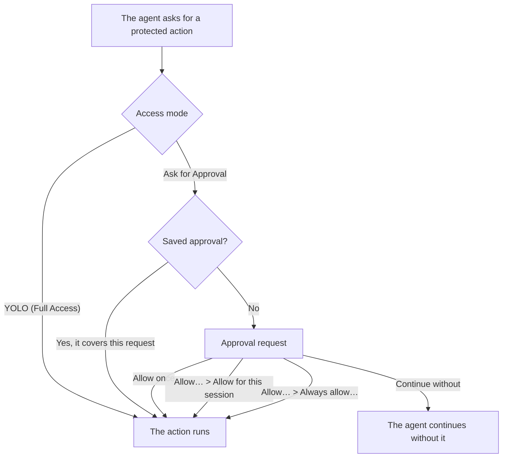

The access mode decides whether the agent asks you before it takes a protected action, such as running a project action, opening the browser preview or calling an MCP tool. **Ask for Approval** shows you each request first, and is the mode to start with while you learn how the agent works. **YOLO (Full Access)** lets those actions run without asking. Neither mode is a read-only mode or an operating-system sandbox, and **Ask for Approval** does not stop for every file edit.

## Choose an access mode

OpenWaggle ships with **YOLO (Full Access)** as the default, so change it if you want approval requests.

1. Open **Settings > Permissions**.
2. Set **Default access mode** to **Ask for Approval**. Every project and session that has not chosen its own mode uses it.
3. To give one repository a different mode, pick it in the project picker. Then, under **Selected project**, choose its mode, or **Use default** to go back to the default.

The project picker only chooses whose permissions you are looking at. It does not move your conversation to that project. A project's mode is saved in its `.openwaggle/settings.json`.

## Change the mode for one session

The agent access menu beside the message box shows the mode the session uses: **YOLO** or **Ask for approval**. Open it to switch this session between **YOLO (Full Access)** and **Ask for Approval**. In a new conversation, your choice applies once you send the first message. A session that has its own mode keeps it, even when you later change the project or app default, so check the menu before you send work.

In YOLO mode, actions that go through OpenWaggle's approval checks run without asking. Tool restrictions and the agent's own questions to you still apply.

## Answer an approval request

An approval request appears above the message box. Read what the agent wants to do, who is asking and what it would touch before you approve. For a command, think about what it does, not only its name. For an outside tool, check which service or account it will reach.

This is the path a protected action takes before it runs:

You have three ways to answer:

- **Allow once** lets this one request through and saves nothing.
- **Continue without** turns the request down, and the agent carries on without that action. If there is another way you want it done, say so in the conversation.
- **Allow…**, when it appears, opens wider choices. **Allow for this session** allows matching requests for the rest of the session. **Always allow…** names the requester, the target and the project it covers, and saves the approval for later sessions too. In the request below, **Always allow** would cover opening the browser preview in the jotter project.

Save an approval only when you understand which later requests it will cover. Approving a request does not make its output safe or the change it makes correct.

## Revoke a saved approval

1. Open **Settings > Permissions** and pick the project.
2. Find the approval under **Saved approvals**.
3. Click **Revoke**, and check that it disappears without an error.

Revoking stops the approval from being used again. It does not undo edits, take back data already sent, or reverse commands that already ran. If saved approvals fail to load, the empty list does not mean there are none, because the old approvals may still be in effect. Click **Retry loading approvals**.

## Project actions and worktree setup

Saving a [project action](/docs/configuration/project-actions) does not give the agent permission to run it. When the agent asks to start, restart or stop an action, the normal approval checks apply. Listing actions, reading their output and reopening one that is already running start no new process.

Setup and cleanup for new worktrees have their own review on your computer. A setup command you save for yourself is turned on for you. A shared one found in `.openwaggle/actions.json` stays off, even in YOLO mode, until you check it. Click **Check it** to read the command and the folder it runs in, then choose **Turn on this version** or **Keep it off**. If the definition changes, you review it again, and closing the review does not approve it. The review covers the definition, not every script it calls, so look at repository changes too.

When setup fails, the first agent turn in the new worktree waits. **Continue anyway** goes ahead without setup. It does not mean setup worked. When cleanup fails, OpenWaggle keeps the worktree. **Delete anyway** skips cleanup and can leave things behind, such as a temporary database.

## What these settings do not protect

An instruction such as "don't edit files" is advice to the model. Nothing enforces it. Review changes in the diff, work on a separate branch or worktree, and keep backups that fit the task.

The terminal is an ordinary shell. Commands and tools can read anything their process can, including credentials in environment variables. MCP servers also run with your user's access. In **Ask for Approval** mode every MCP tool call asks first. Agent access to the browser has its own switch in **Settings > Browser**.

See [Security and privacy](/docs/configuration/security-privacy) for how OpenWaggle handles your data, and [MCP connections](/docs/configuration/mcp) for outside tools.
