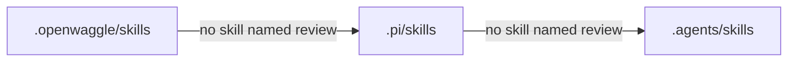
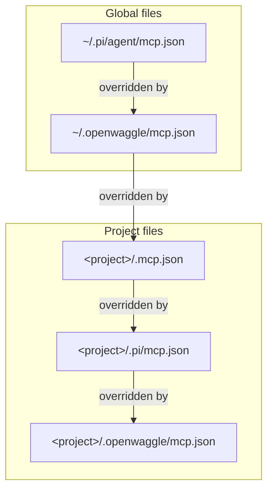

Use Settings for ordinary changes such as connecting a model, choosing an access mode, or changing fonts. Use a project configuration file when you need settings that apply only to one repository.

OpenWaggle reads `.openwaggle/settings.json` in the project root. Keep your real settings file gitignored. If your team needs shared examples, commit a separate non-secret template rather than a file containing personal preferences or credentials.

## Settings file

Use `.openwaggle/settings.json` for advanced project options, such as Worker limits and runtime configuration. Include only the values you need. Top-level keys belong to OpenWaggle; the nested `pi` object configures Pi, the agent engine included with the app:

```json
{
  "sessionHost": {
    "multiAgentEnabled": true,
    "parentConcurrencyLimit": 8
  },
  "pi": {
    "treeFilterMode": "default",
    "branchSummary": {
      "skipPrompt": false
    },
    "compaction": {
      "enabled": true,
      "reserveTokens": 16384,
      "keepRecentTokens": 20000
    }
  }
}
```

`sessionHost.multiAgentEnabled` lets agents create sessions to share work in this project. `sessionHost.parentConcurrencyLimit` is a positive integer limiting simultaneous direct Worker runs under one parent session, not the number of saved conversations. See [Hives and sessions](/docs/using-openwaggle/hives-and-sessions).

For these project controls, values in the file take precedence over older saved project overrides, then app-wide defaults. **Settings > Agents** changes the defaults. Its **Saved project overrides** list can clear older overrides but does not edit your project file.

Pi may also read `.pi/settings.json`. Keep that real settings file untracked too. Prefer `.openwaggle/settings.json` for OpenWaggle configuration, and do not put Pi settings at its top level.

## Resource precedence

Skills, extensions, prompts, and themes can live in these project folders. When the same resource name exists in several locations, OpenWaggle prefers them in this order:

```text
.openwaggle > .pi > .agents
```

Pi matches skills by the `name` in their frontmatter, not by folder name. For a skill named `review`, OpenWaggle stops at the first folder that has one:



For example, `.openwaggle/skills/review/SKILL.md` takes precedence over a skill in `.agents/skills` with the same `name`, whatever its folder is called. This is useful when you need an OpenWaggle-specific version without changing files used by other tools.

A project might contain:

```text
your-project/
  .openwaggle/
    settings.json
    actions.json
    mcp.json
    skills/
    extensions/
    prompts/
    themes/
  .pi/
    settings.json
    waggle-presets.json
    skills/
    extensions/
    prompts/
    themes/
  .agents/
    skills/
    extensions/
    prompts/
    themes/
  .mcp.json
```

You do not need to create every folder. Keep personal settings untracked. Shared resources and `.openwaggle/actions.json` can follow your team's version-control policy. OpenWaggle does not save its automatically added resource paths back into your project settings.

## Project actions and workspace preparation

Manage these in **Settings > Project actions**, which has its own project picker. Actions and preparation definitions are local to the selected project by default. Saving a private definition does not create a repository file or make it available to unrelated projects.

Choose **In the project** for an action, or project storage for setup or cleanup, to save that definition in `.openwaggle/actions.json`. This file is separate from `.openwaggle/settings.json` and is intended for sharing through version control. It contains definitions, not authorization grants, prepared environment values, or run history. Keep secrets out of commands and do not ignore the entire `.openwaggle/` folder if you intend to share resources from it.

Each action, setup, and cleanup has its own storage choice. A private override can customize a shared definition without changing the repository copy. **Restore shared version** removes that override.

Discovering shared setup or cleanup does not enable it. Review and enable the definition locally before automatic execution. Worktrees retain their selected preparation profile's snapshot until you explicitly adopt an update. See [Project actions](/docs/configuration/project-actions) for creating tasks, running services, and preparing workspaces, and [What the shared file contains](/docs/configuration/project-actions#what-the-shared-file-contains) for an example `actions.json` and its fields.

## JSON Schemas for editors

OpenWaggle publishes a JSON Schema for each project file whose format it owns. An editor that knows the schema completes keys and flags mistakes before OpenWaggle reads the file.

| File | Schema | `"$schema"` key |
| --- | --- | --- |
| `.openwaggle/settings.json` | [`project-settings.schema.json`](https://openwaggle.ai/schemas/project-settings.schema.json) | Supported |
| `.openwaggle/actions.json` | [`project-actions-v1.schema.json`](https://openwaggle.ai/schemas/project-actions-v1.schema.json) | Not allowed |
| `~/.openwaggle/mcp.json`, `.openwaggle/mcp.json` | [`mcp.schema.json`](https://openwaggle.ai/schemas/mcp.schema.json) | Supported |
| `.pi/waggle-presets.json`, `~/.pi/agent/waggle-presets.json` | [`waggle-presets.schema.json`](https://openwaggle.ai/schemas/waggle-presets.schema.json) | Removed when Settings saves the file |
| Frontmatter of an agent definition file (`.openwaggle/agents/*.md`, `.agents/agents/*.md` or `~/.openwaggle/agents/*.md`), OpenWaggle v1 format | [`agent-definition-v1.schema.json`](https://openwaggle.ai/schemas/agent-definition-v1.schema.json) | Supported in the frontmatter, see [Agent Definitions](/docs/extending/agent-definitions#openwaggle-v1-format) |

Each schema lives at `https://openwaggle.ai/schemas/` followed by its file name. Where the key is supported, name the schema at the top of the file. OpenWaggle keeps the key when it writes `settings.json` or `mcp.json`:

```json
{
  "$schema": "https://openwaggle.ai/schemas/project-settings.schema.json",
  "sessionHost": {
    "multiAgentEnabled": true
  }
}
```

OpenWaggle rejects an unknown key in `actions.json`, `"$schema"` included. Settings rewrites the Waggle presets file without it. For those two files, tell the editor which schema to use. In VS Code, add this to the project's `.vscode/settings.json`:

```json
{
  "json.schemas": [
    {
      "fileMatch": ["**/.openwaggle/actions.json"],
      "url": "https://openwaggle.ai/schemas/project-actions-v1.schema.json"
    },
    {
      "fileMatch": ["**/.pi/waggle-presets.json", "**/.pi/agent/waggle-presets.json"],
      "url": "https://openwaggle.ai/schemas/waggle-presets.schema.json"
    }
  ]
}
```

The settings schema does not check the `pi` object. It holds Pi's own settings, which [Pi's settings reference](https://github.com/badlogic/pi-mono/blob/main/packages/coding-agent/docs/settings.md) describes.

## MCP config precedence

MCP servers have their own files. OpenWaggle reads them in this order, and for the same server name a later file wins and a project file beats a global one:

```text
~/.pi/agent/mcp.json
~/.openwaggle/mcp.json
<project>/.mcp.json
<project>/.pi/mcp.json
<project>/.openwaggle/mcp.json
```

Each file overrides a same-name server from the files above it, so the later file wins:



See [MCP configuration](/docs/configuration/mcp#where-servers-are-configured) for examples and secrets.

## Thinking level

The thinking level is not a project setting. Each Session keeps its own level, and new Sessions start from Pi's global default. OpenWaggle ignores a `thinkingLevel` preference left in `.openwaggle/settings.json`, and a `defaultThinkingLevel` in the `pi` object or in `.pi/settings.json`. Choose the level with the control beside the message box. See [Thinking levels](/docs/configuration/thinking-levels).

## Runtime settings

The nested `pi` object is for advanced configuration. Use Pi's JSON setting names:

- `treeFilterMode` remembers a Session Tree filter.
- `branchSummary.skipPrompt` skips the summary choice when navigating from an earlier conversation-tree point.
- `compaction.reserveTokens` and `compaction.keepRecentTokens` affect how much space compaction reserves and how much recent context it keeps.

The automatic compaction percentage is app-wide. Set it in **Settings > General > Context compaction**. A project `pi.compaction.thresholdPercent` does not override it.

Appearance preferences and the default **Session environment mode** are also app-wide, not project-file overrides. The background session service's idle grace period is an internal global setting, not a project option.

The old `actions` key is a migration source only. Create and edit new actions through **Settings > Project actions**, using private storage or the dedicated `.openwaggle/actions.json` sharing file.
