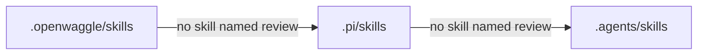
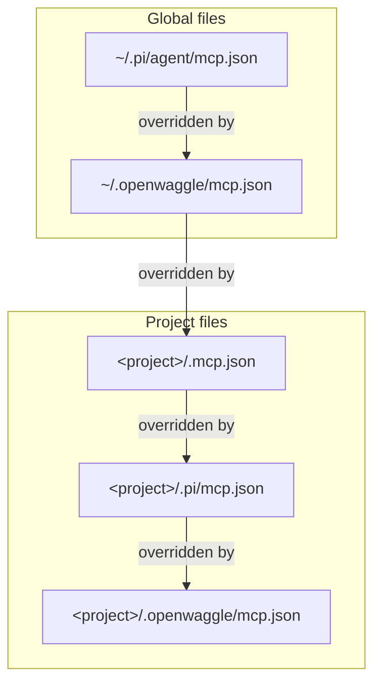

Most changes belong in Settings: connecting a model, choosing an access mode, changing fonts. Use a project file when a setting should apply to one repository only, such as a lower worker limit for a large monorepo, or a skill that only this project needs. OpenWaggle reads project settings from `.openwaggle/settings.json` in the project's root folder. Every file it reads, with its location and JSON Schema, is listed in [Configuration files](/docs/reference/configuration-files).

## Create a project settings file

Create `.openwaggle/settings.json` in the project root and add only the values you need. Top-level keys belong to OpenWaggle. Pi's settings go in a nested `pi` object, with Pi's own names. This file turns on workers for the project, allows 8 worker runs at a time under one parent, and adjusts how Pi compacts:

```json
{
  "$schema": "https://openwaggle.ai/schemas/project-settings.schema.json",
  "sessionHost": {
    "multiAgentEnabled": true,
    "parentConcurrencyLimit": 8
  },
  "pi": {
    "treeFilterMode": "default",
    "branchSummary": {
      "skipPrompt": false
    },
    "compaction": {
      "enabled": true,
      "reserveTokens": 16384,
      "keepRecentTokens": 20000
    }
  }
}
```

`multiAgentEnabled` lets agents start worker sessions in this project. `parentConcurrencyLimit` is a whole number of 1 or more that caps how many worker runs one parent session can have going at once. It does not limit how many conversations you keep. See [Hives](/docs/using-openwaggle/hives-and-sessions).

A value in the file wins over a value an older version saved in the app, and that wins over the app-wide default. **Settings > Agents** changes the defaults. Its **Saved project overrides** list can clear values the app saved, but it never edits your project file.

OpenWaggle also writes to this file. When you pick a mode under **Settings > Permissions > Selected project**, or choose **Always allow** on an approval request, it saves that here. So keep your real `.openwaggle/settings.json` out of version control. If your team wants a shared example, commit a separate template that has no personal choices or credentials in it.

Pi may also read `.pi/settings.json`. Keep that file untracked too. Put OpenWaggle settings in `.openwaggle/settings.json`, and never put Pi settings at its top level.

## Choose what stays app-wide

Some settings cannot be changed per project, and a project file does not override them:

- The thinking level. Each session keeps its own, and new sessions start from Pi's global default. OpenWaggle ignores a `thinkingLevel` left in `.openwaggle/settings.json`, and a `defaultThinkingLevel` in the `pi` object or in `.pi/settings.json`. Choose the level beside the message box. See [Thinking levels](/docs/configuration/thinking-levels).
- The automatic compaction percentage. Set it in **Settings > General > Context compaction**. A project `pi.compaction.thresholdPercent` does not override it.
- Appearance, and the default for **New Sessions run in**.
- How long the background Session Host keeps running when idle. It is an internal setting, not a project option.

The full list of keys, and which `pi` keys OpenWaggle uses, is in [Configuration files](/docs/reference/configuration-files#openwagglesettingsjson-keys).

<a id="resource-precedence"></a>

## Override a skill for OpenWaggle only

Skills, extensions, prompts and themes can live in three project folders. When the same name exists in more than one, OpenWaggle uses the first one it finds, in this order:

```text
.openwaggle > .pi > .agents
```

Pi matches skills by the `name` in their frontmatter, not by the folder name. For a skill named `review`, OpenWaggle stops at the first folder that has one:



So `.openwaggle/skills/review/SKILL.md` wins over a skill in `.agents/skills` with the same `name`, whatever its folder is called. Use this when you want an OpenWaggle version of a skill without changing the files other tools read.

A project that uses every location looks like this:

```text
your-project/
  .openwaggle/
    settings.json
    actions.json
    mcp.json
    skills/
    extensions/
    prompts/
    themes/
  .pi/
    settings.json
    waggle-presets.json
    skills/
    extensions/
    prompts/
    themes/
  .agents/
    skills/
    extensions/
    prompts/
    themes/
  .mcp.json
```

You do not need to create every folder. Keep personal settings untracked. Shared resources and `.openwaggle/actions.json` can follow your team's version-control rules. OpenWaggle never writes the resource paths it adds on its own back into your project settings.

## Share project actions with your team

Project actions and worktree setup are managed in **Settings > Project actions**, which has its own project picker. A new action is saved only for you and only for the selected project. Saving it does not create a file in the repository or make it appear in other projects.

Choose **Everyone working on this project** for an action, or project storage for setup or cleanup, to save it in `.openwaggle/actions.json`. That file is separate from `.openwaggle/settings.json` and is meant to be committed. It holds the definitions only: no approvals, no prepared environment values, no run history. Keep secrets out of commands, and do not ignore the whole `.openwaggle/` folder if you want to share files from it.

Each action, setup and cleanup has its own storage choice. A private version can change a shared definition without touching the repository copy, and **Restore shared version** removes your private version.

OpenWaggle does not run shared setup or cleanup just because it finds it. You review it and turn it on for your own computer first. A worktree keeps the version of its setup profile it started with until you choose to take an update. See [Project actions](/docs/configuration/project-actions), and [What the shared file contains](/docs/configuration/project-actions#what-the-shared-file-contains) for an example `actions.json`. The old `actions` key in `settings.json` is read only to move old actions to their new home.

<a id="json-schemas-for-editors"></a>

## Get completion in your editor

OpenWaggle publishes a JSON Schema for each file whose format it owns. An editor that knows the schema completes keys and marks mistakes before OpenWaggle reads the file.

In `.openwaggle/settings.json` and the `mcp.json` files in `~/.openwaggle/` and `.openwaggle/`, name the schema at the top, as in the example above. OpenWaggle keeps the `"$schema"` key when it writes those files.

Two files cannot keep the key. OpenWaggle rejects any unknown key in `actions.json`, `"$schema"` included, and Settings rewrites the Waggle presets file without it. For those, tell your editor which schema to use. In VS Code, add this to the project's `.vscode/settings.json`:

```json
{
  "json.schemas": [
    {
      "fileMatch": ["**/.openwaggle/actions.json"],
      "url": "https://openwaggle.ai/schemas/project-actions-v1.schema.json"
    },
    {
      "fileMatch": ["**/.pi/waggle-presets.json", "**/.pi/agent/waggle-presets.json"],
      "url": "https://openwaggle.ai/schemas/waggle-presets.schema.json"
    }
  ]
}
```

The settings schema does not check the `pi` object. That object holds Pi's own settings, which [Pi's settings reference](https://github.com/badlogic/pi-mono/blob/main/packages/coding-agent/docs/settings.md) describes. [Configuration files](/docs/reference/configuration-files) lists every schema.

<a id="mcp-config-precedence"></a>

## Decide which MCP file wins

MCP servers have their own files, two for all projects and three in the project. When the same server name appears in more than one, the later file wins, and a project file always beats a global one:



To give one project its own version of a server you also use elsewhere, define it under the same name in `<project>/.openwaggle/mcp.json`. See [MCP connections](/docs/configuration/mcp#where-servers-are-configured) for examples and secrets.
