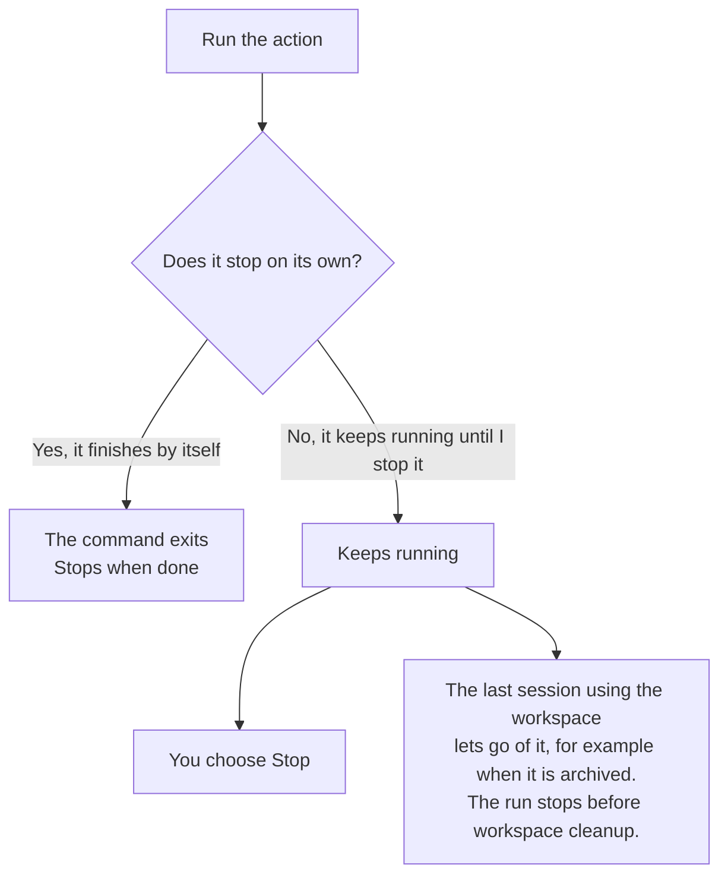

A project action is a command you save for a project so you can run it with one click: your tests, a build, or a development server. You run actions from **Project Actions** in the right panel. Choose its icon on the panel rail along the right edge of the window. The icon shows a dot while one of the session's actions is running. Running and recent runs also appear under **Actions** in [Session Summary](/docs/using-openwaggle/session-summary).

An action runs in the selected session's workspace. For a worktree session, that is its worktree, not the original checkout. Check which session is selected before you run anything that changes files. You can save an action from an empty new-session draft, but you need a session in the project to run it.

The [project actions reference](/docs/configuration/project-actions-reference) lists every option, default, and field of the shared file.

## Save a command as an action

1. Choose **Add action** in the Project Actions panel, or go to **Settings > Project actions** and choose **Add action**. A panel opens on the right and names the project it saves to. Settings has its own project picker, and the panel tells you when that project is not the one your current session is in.
2. Answer **What should it run?** Choose **A script from this project** and pick one, or choose **A command I type myself** and type it, such as `pnpm test`.
3. Answer **What should it be called?** When you pick a script, OpenWaggle suggests a name, such as **Run tests**. Each name must differ from the project's other actions, ignoring letter case.
4. Click **Save action**. Saving does not run the command. If you saved from Project Actions in a session, the confirmation offers **Run now** for that session. If you saved from Settings, the new action is highlighted in the list.


Everything under **Optional settings** has a default, shown in plain words next to each question. Click **Change** only when the default is wrong. The line above **Save action** sums up what will happen. Click it to read the full sentence.

The panel docks beside your work like the other right sidebars. Drag its left edge to resize it. In a narrow window it opens over the app instead. Opening it replaces the sidebar you had open, and closing it brings that sidebar back.

You do not have to finish in one go. If you close the panel or open another sidebar, OpenWaggle keeps what you have so far, even after a restart, and the Project Actions panel offers **Continue new action** or **Continue editing**. A project keeps one unfinished action at a time, so starting another asks whether to continue the one you had or discard it. **Cancel** discards it, and asks first if you changed anything.

### Use a project script

OpenWaggle finds scripts in these files, without running project code or installing dependencies:

| Project | Where scripts come from |
| --- | --- |
| JavaScript and TypeScript | `package.json` scripts at the root and in declared workspace packages, including `pnpm-workspace.yaml` packages |
| Python with Hatch | Environment scripts in `pyproject.toml` or `hatch.toml` |
| Rust | Project Cargo aliases in `.cargo/config.toml` or `.cargo/config` |

Each script in the list shows its package or group and the file it comes from, so you can tell two packages' `test` scripts apart. JavaScript scripts run with the package manager the project declares or the one its lockfile shows. If the lockfiles disagree, OpenWaggle reports it instead of guessing. Other formats, such as `justfile` recipes, need a command you type yourself.

An action made from a script stays linked to it. Each run uses the script as it is in the session's workspace, from the package's folder, so editing the script in the repository changes the next run. If the script disappears, for example on another branch, the action becomes unavailable instead of running an old copy. Editing the action then tells you which script is missing, and lets you keep the link or pick another script. If OpenWaggle saw the command that script ran on this computer, it also offers to use that command instead.

**Copy it as my own command instead** replaces the link with a command you maintain yourself, run in the same folder. The script list rereads the project by itself. If reading fails, choose **Try again** or type a command.

## Run and stop an action

The Project Actions panel lists every saved action under **Run in this session’s workspace**. Each row shows the action's icon and name, the command or script it runs, its keyboard shortcut if it has one, and how its latest run went, such as **Running**, **Ready**, **Completed**, or **Failed**.


- **Run** starts the action in the selected session's workspace. A row is unavailable, with the reason beside it, when its script no longer exists in this workspace.
- **Stop** ends the run. **Restart** stops it, waits for it to end, then starts a new run with the action's current settings.
- **Show output** opens the latest run's output, status, and controls in the panel.
- The terminal icon, **Open in terminal**, shows the same output in the terminal drawer. See [Follow output in the terminal](#follow-output-in-the-terminal).
- **Add action**, and **Continue new action** or **Continue editing**, open the action panel. **Manage actions** opens **Settings > Project actions**.

The panel asks you to open a project when none is open, and to select a session in the project before you run anything. In a narrow panel, a row's controls move below its name.

The output view shows the command, the folder it ran in, its status, and how it exited. Use **Copy output** or **Copy command** to share a failure. A command runs with the same access as any program you start yourself. It is not sandboxed.

Each command gets the project's path and the workspace's path in [two environment variables](/docs/reference/environment-variables#set-for-project-actions-and-terminals). To make an action work in every worktree, give it a folder inside the workspace rather than a full path.

### How runs behave

By default, an action has one run at a time in each workspace. Choosing an action that is already running shows its output. It does not queue another run or interrupt the one going. Different actions, and the same action in different workspaces, run side by side. For an action that finishes by itself, you can change **If you click it while it is still running** to **Start another copy**. That action then keeps **Run**, and **Stop** ends its latest run.

After a run ends, choosing the action starts a new one. Switching sessions or closing the output view does not stop a run. Runs keep going after you quit the desktop app, as long as the background Session Host is still running, and reopening the app reconnects to them without starting another copy. If the process was lost, for example after your computer restarted, OpenWaggle keeps whatever output it has and offers **Restart**. It never starts the action again on its own.

**Restart** checks the current command before it stops the old run. A run's kept output has a size limit, and OpenWaggle marks output it trimmed. **Settings > Project actions** links a running action back to its session.

## Follow output in the terminal

**Open in terminal**, in the Project Actions panel or in a run's output view, opens a read-only tab in the terminal drawer at the bottom of the window. The tab is named after the action, such as **Dev server · action output**, and has a lock icon. It shows the run's saved and live output the same way your terminals do, so colors, scrollback, search, links, and copying all work. It connects to the run that is already going. It does not start a shell, does not run the command again, and does not accept typing.


- Each action has one such tab per session. Choosing **Open in terminal** again brings it to the front.
- When the action restarts, from the panel, a shortcut, or an agent, the tab follows the new run. Earlier output stays above a **restarted** divider.
- When a run ends, the tab keeps its final output and shows how it ended, such as `Dev server failed · exit 1`.
- Closing the tab only closes the view. The action keeps running. Stop and Restart are not in the tab. Use **Stop** in Project Actions.
- After you restart OpenWaggle, action output tabs come back with the terminal drawer and reconnect to the run's saved output.

## Choose whether it stops on its own

Under **Optional settings > Does it stop on its own?**, choose one:

- **Yes, it finishes by itself**, for tests or a build. Settings lists it as **Stops when done**.
- **No, it keeps running until I stop it**, for a dev server or a file watcher. Settings lists it as **Keeps running**.

When you pick a script such as `dev` or `start`, OpenWaggle chooses the second answer for you. Either way you can watch the output or leave the action running while you work elsewhere. There is no separate foreground or background switch. An action that keeps running always has one run at a time.

An action that keeps running stops when you choose **Stop**, or when the last session using its workspace lets go of it, for example when you archive that session. It does not stop while another session still uses the workspace. It always stops before the workspace is cleaned up or removed.

The answer to **Does it stop on its own?** decides what ends a run:



## Open a dev server in the browser preview

Save your server command with **No, it keeps running until I stop it**. Then, under **Optional settings > Open it in the browser preview?**, choose **Yes, open the preview when the server is ready**. Picking a `dev` or `start` script turns this on for you.

OpenWaggle reads the server's address from the run's output and waits until the server answers before it opens the preview. Fill in the preview URL under the same setting only if it opens the wrong address. The address belongs to that run and workspace, so when a server picks a different free port, the preview follows that run's address.

You can also choose **Open preview** in the run's output view once the server is ready. An answer from the server only means it is listening, not that your app works. If startup fails or the page shows an error, check the output and the page itself.

See [Browser preview](/docs/developer-workflow/browser-preview) to inspect the page and send feedback to the agent.

## Share an action with your team

New actions are for you alone by default: **Optional settings > Who should have this action?** is set to **Just me**. OpenWaggle keeps them on this computer, for the selected project. Every worktree of that project gets them, and other projects do not.

Choose **Everyone working on this project** to save the action in `.openwaggle/actions.json`. Commit that file to share the action with your teammates. Saving it does not commit or publish anything. Keep credentials out of shared commands. Sharing an action does not share your approvals, prepared environment values, or run history.

You make this choice for each action. Sharing a test action does not share your other actions, or your setup and cleanup.

When you edit a shared action, the question becomes **Who should get these changes?**. **Only me** keeps the shared version for everyone else and gives you your own version, which Settings marks **Locally overridden**. **Everyone on the project** updates the shared file. To move an action between yours and shared without editing it, use **Storage and removal** in Settings.

### What the shared file contains

Settings writes `.openwaggle/actions.json` for you, so you rarely edit it by hand. You will read it when a teammate's change to it shows up in a pull request. This file shares a test script that stops when done, a dev server that keeps running, and setup and cleanup for new worktrees:

```json
{
  "version": 1,
  "actions": [
    {
      "id": "test",
      "name": "Run tests",
      "icon": "test",
      "invocation": {
        "type": "task",
        "task": {
          "provider": "package-script",
          "source": "package.json",
          "task": "test",
          "directory": "."
        }
      },
      "kind": "task",
      "allowConcurrent": false,
      "autoOpenPreview": false
    },
    {
      "id": "web-dev",
      "name": "Web dev server",
      "icon": "play",
      "invocation": {
        "type": "command",
        "command": "pnpm dev --port 5173",
        "directory": "apps/web"
      },
      "kind": "service",
      "allowConcurrent": false,
      "autoOpenPreview": true,
      "previewUrl": "http://localhost:5173"
    }
  ],
  "profiles": [],
  "preparation": [
    {
      "id": "install",
      "profileId": "default",
      "phase": "setup",
      "invocation": {
        "type": "command",
        "command": "pnpm install --frozen-lockfile",
        "directory": "."
      }
    },
    {
      "id": "stop-containers",
      "profileId": "default",
      "phase": "cleanup",
      "invocation": {
        "type": "command",
        "command": "docker compose down",
        "directory": "."
      }
    }
  ]
}
```

When a save clashes with an edit made outside OpenWaggle, Settings keeps both drafts and shows them under **Inspect pending drafts**. [Recovery files](/docs/configuration/project-actions-reference#recovery-files) explains the copies OpenWaggle keeps and when you can delete them.

If the file is missing a key or has one OpenWaggle does not know, OpenWaggle does not guess. **Settings > Project actions** shows the error, and none of the project's actions work, your own included, until you fix the file. Each field is described in [The actions.json file](/docs/configuration/project-actions-reference#the-actionsjson-file). The file has a JSON Schema, but do not add a `"$schema"` key, which counts as an unknown key. To get completion in your editor, link the schema to the file as shown in [JSON Schemas for editors](/docs/configuration/per-project-config#json-schemas-for-editors).

## Set up new worktrees

Setup is a command that prepares a new worktree before the agent starts, for example by installing dependencies. It is separate from the actions you run yourself. Configure it in **Settings > Project actions > Workspace preparation**:

1. Under **Set up new worktrees**, click **Configure**. The same panel opens.
2. Answer **What should it run?** with a project script or a command that finishes, such as the project's install command.
3. Check **Who should have this setup?** and the folder under **Optional settings**, then click **Save setup**.

Saving a setup turns it on for you, whether you keep it to yourself or share it, because you have just seen exactly what will run. The one exception is a teammate's change waiting for your review. If you save it without changing its command or folder, it stays off until you check it, and the message after saving says so.

A shared setup needs each teammate's review before it runs on their computer, and a later change by someone else needs your review. Settings shows **Check it before it runs** for those. **Check it** opens the panel with what changed since the version you last turned on, in plain words. Choose **Turn on this version** or **Keep it off**. Closing the panel leaves the setup off. When a new worktree, or a worktree removal, is waiting on that review, the panel opens by itself.

When you create a managed worktree, setup must finish before the agent's first turn starts. If it fails or you stop it, that turn pauses and offers **Retry setup** or **Continue anyway**. **Stop setup** stops the attempt that is running before the workspace is released for other work.

Opening an existing checkout, or sending a message in it, does not run setup. To run it there, go to the **Workspace preparation** section of Session Summary, pick a profile if there is more than one, and choose **Run setup**.

When setup succeeds, OpenWaggle keeps the environment changes it exported, for that workspace only. Later agent commands and action runs get them, and variables the setup removed stay removed for later actions, cleanup and the agent's commands. Processes already running do not. A failed setup passes on no environment changes. Keep development servers as actions that keep running, not as setup commands that never finish.

### Use more than one setup profile

Profiles let different kinds of work use different setups. They stay out of sight until you need one. Choose **Add another setup profile** in the same section. Once a project has more than one, Settings shows a **Setup profile** picker, and the panel names the profile it edits. When you create a managed worktree in that project, you choose its profile.

A worktree keeps a copy of its profile's setup and cleanup as they were when it was created. Editing the profile later does not change that worktree. Session Summary shows **A newer profile version is available** when there is one. **Adopt updated profile** replaces the worktree's copy, clears its prepared environment, and asks for setup again. A worktree whose copy you already reviewed can still run it, even after the project's profile has changed.

The copy holds the commands and script references, not the scripts themselves. Changes inside those scripts still affect what runs.

### Clean up worktrees

Set an optional cleanup command under **Clean up worktrees** in the same section. Cleanup runs before OpenWaggle removes a managed worktree, after the last session lets go of it, while its files are still there. Setup and cleanup each have their own **Just me** or **Everyone working on this project** choice. When a private setup or cleanup and a shared one are in the same profile and step, the private one runs. **Restore shared version** removes the private one. Storing the private one in the project replaces the shared step with it.

If cleanup fails, OpenWaggle keeps the worktree. In **Settings > Worktrees**, look at **Cleanup output** and choose **Retry cleanup**. **Delete anyway** skips cleanup and can leave behind resources that setup created outside the worktree. It is not the same as **Force remove**, which can also throw away uncommitted changes or remove a locked worktree.

## Add a keyboard shortcut

In the action panel, **Optional settings > Keyboard shortcut** records one key combination for the action. Use Command, Control, Alt, or Shift with a key. If the combination already does something else, the panel says what and asks whether to use it anyway.

For conditions or more than one shortcut, choose **More shortcut options**, or open **Settings > Shortcuts > Add binding**. In **Command**, choose your action under **Project Actions**, record a key combination, then click **Add binding**. Backspace or Delete clears the combination while you record.

Conditions limit when a shortcut applies. A condition that names a context the app does not know is false until the app provides it. Read any overlap warnings. Project action shortcuts win over built-in ones, and within each list the last matching rule wins. You manage built-in shortcuts and project action shortcuts in the same place.

## Edit or remove an action

In **Settings > Project actions**, click **Edit** beside an action and finish with **Save changes**. Changes apply from the next run, not to a run already going. If the saved action changed after you started editing, for example through `git pull`, the panel lists what changed and asks whether to **Keep my changes** or **Use the new version**. It never overwrites the other change without asking.

**Remove this action**, at the bottom of the panel, tells you what removing means before anything is removed. For an action you overrode locally, the button is **Restore shared version** instead. Removing an action does not undo commands it already ran. To end a run that is going, use its **Stop**.

Two actions can have the same name, for example when a teammate shares one with the same name as yours. Both keep working. The Project Actions panel tells them apart with a gray hint, and Settings offers **Rename**.

Actions saved by older OpenWaggle versions become ordinary actions kept on this computer, with their name, command, shortcut and preview choice. An older worktree setup choice becomes the setup of the default profile, which waits for your review before it runs, and the original action stays available. The conversion keeps a local recovery copy and runs nothing. OpenWaggle no longer saves actions under the `actions` key of `.openwaggle/settings.json`.

## Fix a failing action with the agent

When a run fails or is interrupted, it may offer **Fix with agent**. That adds a repair request to your message draft. Review it and send it. The agent suggests a command that works, and its reply shows **Review and save**. That opens the panel with the suggestion and what it changes. Nothing changes until you save. A command you typed yourself may need changes to work on another operating system.

## Let the agent use actions

Agents can list actions, read runs and their output, and ask to start, restart, or stop them. They use the same runs you see in the panel. Saving an action does not give the agent permission to run it. See [Approvals and permissions](/docs/configuration/approvals-permissions).
