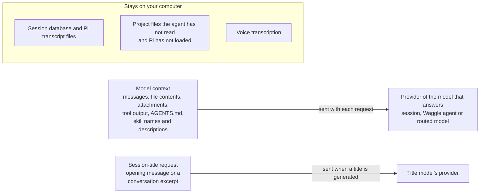

Read this page before you use OpenWaggle on code or data you need to keep private. OpenWaggle keeps your sessions on your computer, but a local session is not a local AI request. When you use a hosted model, your messages, and any file contents, attachments or tool output in the model's context, go to that model's provider, and the provider's data policy applies.

## What leaves your computer

Each model request sends the model's context to the provider of the model that answers it. That is the session's model, each agent's model in a [Waggle](/docs/using-openwaggle/waggle-mode), or the real model a [virtual model](/docs/providers/virtual-models) routes the request to. Compaction and branch summaries are model requests too. A [codemode](/docs/using-openwaggle/codemode) script can send what it passes to the classifier or image models it calls.

Some text goes to a model without the agent reading it. Pi adds [project instruction files](/docs/extending/agents-md) such as `AGENTS.md`, and the names and descriptions of the available skills, to the context. Titling a session sends the opening message to the title model, which can belong to a different provider. Refining the title after the first reply, or regenerating it, sends an excerpt of the conversation and the names of its attachments.

A local model endpoint can keep the model requests on your machine. Tools, extensions, browser pages and MCP servers can still reach the network, so a local model alone does not make your work offline. OpenWaggle itself also contacts the network, as described in [Usage statistics and update checks](#usage-statistics-and-update-checks) and [The session search model](#the-session-search-model).

## Before you work on sensitive code

- Check which provider you selected, and whether your organization allows sending this code to it.
- Choose **Ask for Approval** in **Settings > Permissions** if you want to review protected actions. It does not ask before every edit, and it does not make the session read-only.
- Review MCP servers, extensions, browser profiles and saved approvals before you use them with the project.
- Keep secrets out of messages, committed configuration and shared logs.
- Review the diff before you commit.

## What OpenWaggle keeps on your computer

OpenWaggle keeps its settings and sessions in its app data folder. The session database is `session-host/session-host.sqlite`. Pi, the agent engine inside OpenWaggle, also keeps a transcript file for each session. Treat conversations, attachments, logs and terminal history as sensitive. [Data and file locations](/docs/reference/data-locations) lists where each kind of file lives on your platform.

Provider credentials are not in the session database. They come from Pi's `auth.json`, from environment variables, or from custom provider configuration. `auth.json` is in Pi's agent folder, `~/.pi/agent` unless `PI_CODING_AGENT_DIR` moves it. It is plain JSON, not encrypted like OpenWaggle's MCP secrets, so protect it as you would any secret file. Every Pi client that uses the same folder shares the credentials in it.

OpenWaggle stores MCP servers, secrets and sign-ins apart from both, and it encrypts the secrets and sign-ins. OpenWaggle reads Pi's own `mcp-auth.json` but never changes it. See [Where servers are configured](/docs/configuration/mcp#where-servers-are-configured). For the recovery copy of an older session database, see [Recover an older session database](/docs/configuration/session-recovery#recover-an-older-session-database).

## Usage statistics and update checks

Released builds send anonymous usage statistics and error reports to OpenWaggle from the first launch. They never include your prompts, code, file paths or project names, or any identifier for you or your install. Turn both off in **Settings > General**, or with `DO_NOT_TRACK=1`. [Usage statistics and error reports](/docs/configuration/usage-statistics) lists what OpenWaggle sends, where it goes, and your rights under the GDPR.

Released builds also ask GitHub for updates a few seconds after launch and every 4 hours, so GitHub receives your IP address. The statistics switch does not stop these checks. See [Update checks](/docs/configuration/usage-statistics#update-checks).

## The session search model

Search by meaning uses a model that runs on your computer. OpenWaggle does not ship it. The Session Host downloads it from Hugging Face (`huggingface.co`) the first time it needs it: when it indexes your sessions in the background, or when you run a search by meaning. The download is about 135 MB, from one pinned revision of `Xenova/multilingual-e5-small`. Hugging Face receives your IP address, and no session text leaves your computer.

OpenWaggle checks each file against its pinned SHA-256 hash before it uses the model, and refuses a file that does not match. The model is kept in the app data folder, so updates do not download it again. Until it arrives, search matches words. A failed download is tried again after 15 seconds, then after twice as long each time, up to every 30 minutes.

## Voice input

Voice transcription runs on your computer. OpenWaggle may download the speech model on first use, but it never sends your audio to a speech-to-text service. Once you send the transcribed text, it goes to the model provider like any typed message.

## The terminal and the agent's shell

The built-in terminal is a shell you control, not a sandbox. Its commands, and the programs they start, can read any file or credential your account can.

Each terminal starts with a fresh copy of the app's environment, so your toolchains, locale, SSH agent, proxies, display settings and exported variables keep working. OpenWaggle removes its own control variables and the Electron and Node.js variables that can inject code. On Linux it also removes the AppImage runtime paths, and it sets the terminal type variables. This cleanup does not filter out secrets. [Environment variables](/docs/reference/environment-variables#set-for-project-actions-and-terminals) lists what it changes.

OpenWaggle keeps recent terminal output in its app data folder, so a pane can show its scrollback again after a restart. It keeps at most 5,000 lines and 10 MiB for each terminal, in folders and files only your account can open on platforms that support that. Closing a pane or tab, or deleting its session, deletes that terminal's saved output.

After a full restart, OpenWaggle strips terminal queries, clipboard controls, input modes and full-screen state from old output before it shows it again. The text itself can still contain secrets.

The agent's `bash` tool is not the built-in terminal. Pi runs it, so don't assume the terminal's shell, startup files or environment cleanup apply to the agent's commands.

### Links and selections in the terminal

Cmd-click on macOS, or Ctrl-click on Windows and Linux, follows a terminal link. OpenWaggle opens HTTP and HTTPS links, safe `file:` links and file references it recognizes. It refuses other schemes.

A file inside the session's working folder can open inside OpenWaggle. A file outside it opens only in the external editor you chose before. Opening a file this way does not give the agent access to that location.

**Add selection to chat** puts the selected terminal output beside your draft, as an item you can remove. It includes the working path and checkout details, and marks the text as untrusted output. Nothing goes to the model until you send the draft. Command output can be misleading or hostile even when a local command produced it.

## Browser previews

When **Settings > General > Open web links in** is set to **OpenWaggle**, web links open in a browser preview that belongs to the session. The page runs in a sandbox with Node integration turned off. The preview refuses every permission request except clipboard writes, which Chromium sanitizes. It blocks downloads, device access, certificate exceptions, user names and passwords in URLs, popups you have not allowed, and navigation to anything other than HTTP or HTTPS. You can always open the current page in your system browser instead.

A hidden preview can stay open so that background agent work can continue. Closing it, deleting its session, closing the app window or quitting the app ends it. Reloading OpenWaggle's own window keeps its previews, but navigating that window away from the app closes them. If a preview page crashes, OpenWaggle reloads it at most three times in 30 seconds. Navigating, replacing the page or closing the tab stops those reloads.

### Profiles and imported cookies

Each saved browser profile has its own cookies and site data. Incognito keeps them in memory only. Importing cookies copies them into an OpenWaggle profile and never changes the browser you import from. Decrypting them may use your operating system's credential helper.

On Windows you can import from Firefox and Helium only. OpenWaggle cannot safely decrypt the app-bound cookie encryption of Chrome 127 and later, so it does not offer other Chromium browsers there.

Imported cookies can sign the preview in to your accounts. Check what an account allows before you let an agent use that profile. Incognito does not hide your traffic or stop a website from receiving what you submit.

### Letting agents use the browser

Agents can use the preview only when **Settings > Browser > Let agents open and drive the preview browser** is on. When it is off, or OpenWaggle cannot read the setting, agents get no browser tools and no instructions about them. Every browser action checks the setting again, including in work already running.

When it is on, browser actions still ask for approval where your permissions require it, work only on the preview of the agent's own session, and stop when the run is cancelled. Typing or clicking in the preview takes control back from the agent. See [Approvals and permissions](/docs/configuration/approvals-permissions).

### Annotations

Browser annotations run apart from the page's own JavaScript. OpenWaggle limits the size of the selected elements, regions, drawings, text and page details before it accepts an annotation. OpenWaggle undoes style previews once it has taken the screenshot or you cancel.

The attachment marks selectors, HTML, computed styles and other details from the page as untrusted. An annotation goes to the model only when you send the draft. It includes React source locations only when the page exposes reliable development information.

## How the desktop app is isolated

The app's interface runs with Node integration turned off, context isolation on, a sandbox, and a strict Content Security Policy. It reaches the app's privileged functions only through a typed preload bridge.

That keeps the interface apart from privileged operations. It does not sandbox your terminal, prove that an extension is safe, or stop a model request from containing code you asked the agent to look at.
