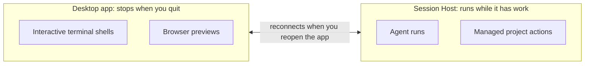

Use this page when OpenWaggle stops doing what you expect: a model will not answer, a session sits waiting, a worktree has gone missing, or work seems to continue after you close the app. Start with the problem you can see, and read the error or the pending request before you retry. Restoring an old session database fixes none of these. The last section covers it, for the rare case where an upgrade's database migration is the problem.

## Fix an unavailable provider or model

1. Open **Settings > Connections** and find the provider you selected beside the message box.
2. For an API key provider, expand **API Key Providers** and check its status. Use the pencil icon to enter a key, choose **Test**, then **Save**. Testing a key does not save it.
3. For a provider you sign in to in the browser, expand **OAuth Providers** and check that it says **Connected**. Finish any sign-in steps it shows, or choose **Try again** after an error.
4. Under **Available Models**, turn on the model you want. The model menu beside the message box lists a model only when it is turned on and the provider's current credentials can reach it.
5. Select the model under the provider you connected, and send a short message to test it.

**Configured outside OpenWaggle** means OpenWaggle found credentials in environment variables, cloud credentials or custom provider configuration. You do not need to paste another key to change that status. If the provider belongs to one project, check that you have that project selected.

If the provider is connected but requests still fail, read the error. It usually names the cause: account access, billing, quota, rate limits or the network. Signing in does not give you access to every model. See [Providers and models](/docs/providers/overview), [API key authentication](/docs/providers/api-key-auth) and [Browser sign-in](/docs/providers/oauth-auth).

### Provider credentials expired

If a run ends with **Provider credentials expired**, renew the credentials and send your message again. For Amazon Bedrock with an AWS SSO profile, run `aws sso login` for that profile. For a provider you signed in to in the browser, sign in again in **Settings > Connections**.

When an Amazon Bedrock request fails on expired credentials, OpenWaggle tries it once more after 2 seconds before it ends the run. That way a token another request refreshed in the meantime still works. The retry reads your AWS credentials and config files again, so temporary keys that a login tool such as saml2aws replaced while OpenWaggle was running work without a restart. If AWS refuses an access key you have already replaced, for example after a key rotation, that request fails and your next message uses the new key.

## Answer a session that is waiting

Open the session and look above the message box for **Waiting for you** or an approval request. The agent may need an answer, a choice or your permission before it can go on.

Read the request and answer it there. For a protected action, **Allow once** lets it go ahead and **Continue without** declines it. Don't switch to full access just to get rid of a request you have not understood. See [Approvals and permissions](/docs/configuration/approvals-permissions).

Your message may be in the follow-up queue, waiting for the current work to finish. When the agent ends a run, OpenWaggle takes a moment to save it and shows **Finishing…** in place of the stop button. A message you send then waits in the queue and starts as soon as the run is saved.

When a run fails or you stop it, the follow-ups already queued pause, and the queue says why. A message you send after that counts as a retry and runs normally. The earlier follow-ups stay paused until you choose **Resume**, so look at any item that needs attention first. Sending the same task again and again can queue duplicate work. See [Conversations and tools](/docs/using-openwaggle/chat-and-tools).

## Recover a missing worktree

If the worktree of an existing session was deleted, OpenWaggle stops new messages in that session and offers two choices:

- **Recreate worktree** checks out the session's branch in a new worktree. Commits on that branch come back, but uncommitted files deleted with the old folder do not.
- **Use current checkout** moves the session to the project folder you opened. The agent's next edits change that checkout, so check its branch and uncommitted work first.


If OpenWaggle could not create the worktree for a new session, open **More details** on the **Worktree setup failed** card. Fix the Git problem it reports and choose **Retry**. **Cancel** puts your message back in the draft. **Work locally** sends it again in the current checkout instead.

These choices change where the session works. Restoring the session database never brings back deleted files. See [Projects and worktrees](/docs/developer-workflow/projects-and-worktrees#recover-a-missing-worktree) for what a recreated worktree keeps.

## Fix a worktree that no longer matches its preparation

Each managed worktree records the folder it was prepared in. If a different folder is at that path now, new messages and project actions in the session fail with "This worktree no longer matches its saved preparation". The message gives the path. When a different folder is there, it also gives the inode and creation time of both folders.

OpenWaggle 1.0.0-beta.21 and earlier could also show this error after you restarted a Mac, when nothing had changed. If you see it right after a restart, update to a version newer than 1.0.0-beta.21 and try again before you delete anything. If you have not moved or replaced the folder and no newer version is out yet, leave the folder where it is. The worktree has not changed.

Otherwise, fix it like this:

1. If the original folder still exists somewhere else, put it back at that path in place of the folder there now, and send your message again.
2. If it does not, commit or copy out any changes you want to keep from the folder at that path, then delete the folder. Don't just move it, because a moved copy of a worktree still uses the Git data that **Recreate worktree** reuses.
3. Reopen the session and choose **Recreate worktree** or **Use current checkout**, as for a missing worktree.

The error "This worktree cannot be checked against its saved preparation" has two causes. If the message says the folder could not be read, fix the permissions of that folder or the folders above it and send your message again. Don't delete it. Otherwise the preparation never recorded this folder, so follow steps 2 and 3. If the app stopped while it was creating the worktree, versions newer than 1.0.0-beta.24 record the folder on your next message or project action instead of showing this error. A worktree an earlier version left in that state still needs steps 2 and 3.

For a worktree no session uses any more, **Remove** in **Settings > Worktrees** works as usual if no cleanup was set up when the worktree was prepared. If one was, **Settings > Worktrees** explains why that cleanup cannot run and offers **Delete anyway**. For a session's own worktree, follow the steps above.

## Check on work after closing the app

Closing or restarting the desktop window does not stop agent work. The Session Host, OpenWaggle's background service, keeps it running. Reopen the app and select the session to see how it is going.

The Session Host runs agent runs and managed project actions. Terminal shells and browser previews belong to the desktop app and stop when you quit it:



When no desktop app or other client is connected and no work is left, the Session Host exits after 5 minutes by default. An enabled scheduled task keeps it running.

To stop work, click the square **Cancel** button beside the message box and wait until the run has stopped. Check the last tool results and file changes before you ask the agent to carry on. Cancelling cannot undo edits already made, or take back a request already sent to an outside service.

Quitting the desktop window does not stop the Session Host. The database recovery commands below need the database to themselves, so they refuse to run while another process holds it. Don't delete ownership files or force access to get past that.

## Archive a session when desktop tools are paused

If archiving a session fails with "An attached OpenWaggle desktop is required", and a banner says **Desktop tools are paused**, the last OpenWaggle window closed without confirming that its terminals and previews had stopped. Check that nothing you started from its terminals is still running, then choose **Recover desktop tools** on the banner. See [Recover after the app closes](/docs/developer-workflow/built-in-terminal#recover-after-the-app-closes).

## Collect details before asking for help

Copy the error message, and note the provider, model, project and working folder you were using. [Data and file locations](/docs/reference/data-locations#logs) says where the logs are. Check logs for secrets and private code before you share them. For a problem with an MCP server, see [When something fails](/docs/configuration/mcp#when-something-fails).

## Recover an older session database

When an upgrade moved your sessions out of the older `openwaggle.db` database, OpenWaggle kept a recovery copy of it. The commands below inspect, restore or delete that copy. They do not undo an agent's mistake, a failed request, or changes to project files.

Restoring puts the older copy in place of your current session history. Sessions, and changes to sessions, made after the migration disappear from the restored history. So check the recovery status first, and don't restore just because a model request failed.

### Inspect the recovery copy

Run this in your terminal:

```sh
openwaggle recovery status --json
```

It shows the paths, sizes and dates of the active database and the recovery copy, and whether the active database's schema is compatible. Checking the status does not start the Session Host. A fresh install may have no recovery copy.

`legacy` in the result lists old database files left at the top of the app data folder: `openwaggle.db` and `session-host.sqlite`. Current versions write neither. A file with `"empty": true` is 0 bytes and holds nothing, and restoring and upgrading treat it as missing. An `openwaggle.db` that holds data blocks restoring until you move it somewhere else.

Save the result and back up important work before you decide to restore. The recovery copy is not a backup of your Git checkout or your worktrees.

### Restore the recovery copy

1. Let agent work finish, and quit every OpenWaggle window.
2. Make sure the Session Host has stopped. Closing a window alone may leave work running.
3. Once you accept losing newer session history, run:

```sh
openwaggle recovery restore-pre-cutover --yes --json
```

The command needs the database to itself. If it reports that another process holds it, stop the remaining OpenWaggle work or clients and try again. Don't delete lock or ownership files to force it.

Before it replaces anything, OpenWaggle saves the current database under a name with the date and time. It first removes an empty `openwaggle.db` that is in the way. Then it migrates the recovery copy again. If restoring fails, it puts the current database back.

OpenWaggle never restores the recovery copy on its own, whether after a crash, a failed agent request or a validation error.

### Delete the recovery copy

Delete the copy only after you have checked that your migrated history is right and you no longer need it. Stop the Session Host first, then run:

```sh
openwaggle recovery delete-pre-cutover --yes --json
```

This deletes the recovery copy for good, and reports the path and size it removed. Normal use of the app never needs it.

### What the upgrade keeps

The one-time migration builds a new database beside the old one. It keeps the IDs of sessions and transcripts, rebuilds which working folder each session uses and the text search index, and checks the result before it switches over. If the migration fails or is cancelled, the old database stays as it was, and OpenWaggle never opens a half-built new one.

After a successful migration, OpenWaggle uses `session-host/session-host.sqlite` in the app data folder. The recovery copy is `session-host/pre-cutover-openwaggle.sqlite` in the same folder. Normal use never reads or writes it, and a record of the migration stops the upgrade from running again.

Search by meaning needs a second index that builds in the background. It can show `preparing` or `failed` while text search keeps working.

It also needs the session search model, which OpenWaggle downloads on first use ([The session search model](/docs/configuration/security-privacy#the-session-search-model)). Until the model arrives, readiness is `preparing` while its `model.state` is `missing` or `downloading`, and `unavailable` while it is `offline` or `failed` and waiting to try again, unless the index already reports `failed` or `unavailable`. Search falls back to matching words in the meantime. Hybrid search, which combines the two, uses text search alone until enough of that index is ready. After a restart, OpenWaggle carries on building the index without running the database migration again.

### Command errors

With `--json`, a result goes to standard output in the same envelope as the [Hive CLI](/docs/developer-workflow/hive-cli#error-kinds-and-exit-codes), such as `{"schemaVersion":1,"type":"response","command":"recovery status","result":...}`. A failure goes to standard error in this shape:

```json
{"schemaVersion":1,"type":"error","error":{"kind":"usage","message":"..."}}
```

Failures include invalid options, a missing `--yes`, another process holding the database, and file or migration errors. Without `--json`, a failure prints `error [<kind>]: <message>`. Usage errors, including a missing `--yes`, exit with code `2`. Other failures exit with the code of their kind, `1` for most. Read the message before you retry, especially when it names a database or recovery path.
