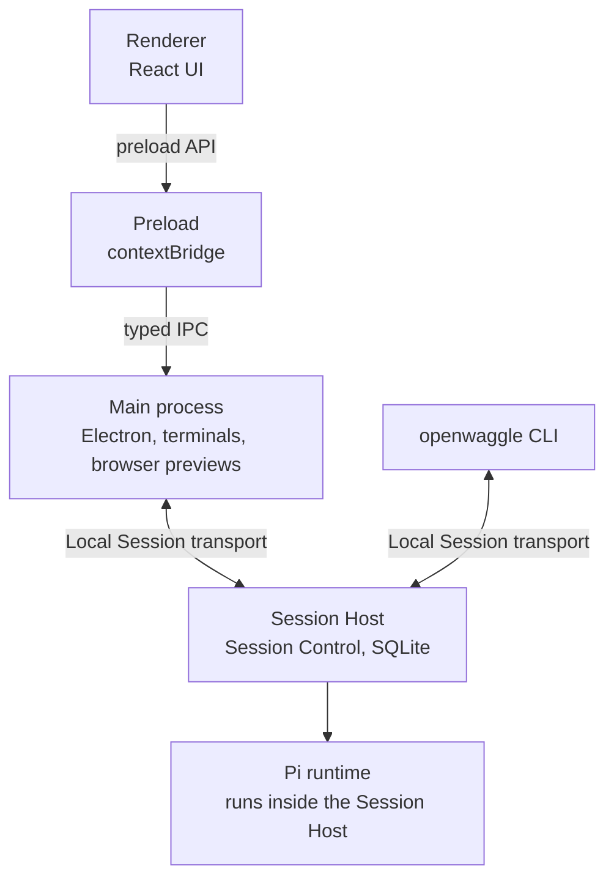

This page helps you find where a change belongs in the source. OpenWaggle is an Electron desktop app, and Pi runs the agents. A separate local process, the Session Host, runs sessions and keeps their saved state. The desktop app and the `openwaggle` command are both clients of the Session Host.

For setup commands, see [Building from source](/docs/developer-guide/building-from-source). For how OpenWaggle uses Pi, see [Pi runtime](/docs/developer-workflow/pi-runtime).

## Source folders

| Folder | What it holds |
| --- | --- |
| `src/main/` | The Node.js side: ports, adapters, IPC handlers, and the SQLite projection |
| `src/preload/` | The typed `contextBridge` API the renderer calls |
| `src/renderer/src/` | The React 19 UI |
| `src/shared/` | Types and schemas that import no vendor code |

The renderer has no direct Node.js access and imports nothing from the Pi SDK. It talks to the main process only through the typed IPC that preload exposes.

## Processes

At run time these are separate processes. The Session Host is a detached process, and the desktop app and the CLI both connect to it:

## Ports and adapters in the main process

The main process keeps business logic apart from infrastructure with ports and adapters. App code imports the Pi SDK only in `src/main/adapters/pi/`. The dedicated `packages/pi-*` packages may use Pi inside their own package.

| Folder | What goes there |
| --- | --- |
| `domain/` | Pure business logic, with no infrastructure or vendor imports |
| `ports/` | Effect service interfaces, such as `AgentKernelService`, `ProviderService`, and the session repositories |
| `adapters/` | The implementations, including the Pi and SQLite adapters |
| `application/` | Business workflows, written against ports |
| `ipc/` | Input checks, calls to application services, and IPC responses and events |
| `store/` | SQLite storage code that adapters use |

## What happens when you send a message

1. The renderer calls `agent:send-message`.
2. The IPC handler passes the call to application services. Session commands go to the Session Host that owns the session.
3. `AgentKernelService` resolves to the Pi adapter.
4. The Pi adapter creates Pi services for the project and the selected provider-qualified model.
5. Pi runs the session with the tools enabled for that run.
6. The adapter translates Pi events into OpenWaggle's own `AgentTransportEvent` values.
7. The Pi session file stays the record of what happened. SQLite projection tables keep the sessions, nodes, branches, and UI state that navigation and display need.

The renderer reads the session projection through OpenWaggle's own IPC data types. The Session Tree selection, branch rows, draft branch state, and the `branch` and `node` search parameters in the route are all UI on top of that projection. None of them are Pi SDK objects.

[Pi runtime](/docs/developer-workflow/pi-runtime#follow-a-message-through-the-app) follows the same message across the processes in more detail.

## Providers and models

Provider, model, and sign-in data comes from Pi's `ModelRuntime`. OpenWaggle passes it through ports and IPC data types, so the settings UI can choose which models are enabled.

## Tools

Pi runs the tools. OpenWaggle shows the tool events Pi emits directly in the transcript.

## Project resources

OpenWaggle passes Pi the project's resource folders for skills, extensions, prompts, and themes, in this order: `.openwaggle`, then `.pi`, then `.agents`. An eligible extension package can add the folders it declares, ahead of `.pi`. Extension code that OpenWaggle manages also needs the package to be approved first. Skill switches filter the list of loaded skills, including skills with a matching name outside the app's two catalog folders. Pi still does the loading.

## Project actions and workspace setup

`ActionRunService` runs managed task and service processes, keeps their output, and stops or restarts them. `WorkspacePreparationService` runs setup and cleanup and keeps the prepared environment. Before a run starts, the Pi adapter prepares the session's workspace and gives the prepared environment to its shell tools. The `project_actions` tool and the buttons in the app use these same Session Host services. Neither types commands into a terminal pane.

## Tech stack

| Part | Technology |
| --- | --- |
| Framework | Electron 43 with electron-vite |
| Agent runtime | The Pi SDK, behind OpenWaggle's ports and adapters |
| Main process logic | Effect |
| UI | React 19, Zustand, Tailwind CSS v4 |
| Storage | SQLite for read models and local state, Pi JSONL files for run history, `.openwaggle/settings.json` for project configuration, and `.openwaggle/actions.json` for project actions |
| Terminal | xterm.js with node-pty |
