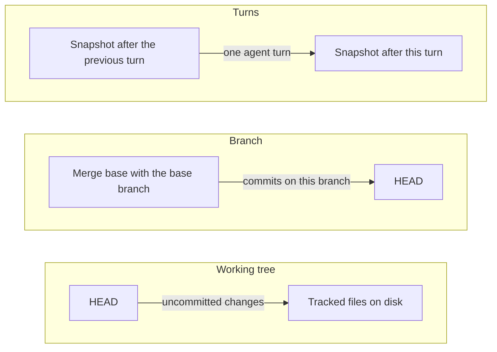

The agent edits files on disk as it works. The diff panel shows you what changed, so you can review the edits, send corrections, and commit or push when you are happy. Opening the diff does not approve or apply anything: the edits are already in your files.

For a first review:

1. Open the session and press `Cmd+D` on macOS or `Ctrl+D` on Windows and Linux.
2. Check the working-directory label, then select **Working tree** for uncommitted changes.
3. Choose a file and read its diff. Changes made by you or by another session in the same checkout appear here too.
4. Click a changed line, write a correction, and choose **Add comment** to send it to the agent.
5. Review the updated files and test results. Commit when you are satisfied.

Every Git view follows the checkout the session works in. For a session with its own worktree, that is the worktree, not the folder you opened. [Projects and worktrees](/docs/developer-workflow/projects-and-worktrees) explains how to choose.

## See how much changed

The header shows the session's uncommitted changes as a green `+N` for added lines and a red `-N` for deleted lines. Click the numbers to open or close the diff panel.

The numbers refresh when you switch projects or sessions, when a commit finishes, shortly after the agent finishes a turn, when the window gets focus back, when another window changes the same checkout, and when you click **Refresh** in the commit dialog. The diff panel's own **Refresh diff** button reloads only the diff, not the header numbers.

Each session in the sidebar has its own Git indicator. It shows commits ahead of and behind the upstream branch, such as `↑2` and `↓1`; hover the branch icon for the branch name. The sidebar does not count uncommitted files. Use the diff panel for those.

After the first message, **Changes** in the [Session Summary](/docs/using-openwaggle/session-summary) opens the same diff, next to the branch and the commit, push and pull request actions.

## Open the diff panel

Press `Cmd+D` or `Ctrl+D`, click the change numbers in the header, or choose **Changes** on the [panel rail](/docs/using-openwaggle/right-panel). The diff opens in the right panel, in place of any other panel that was showing there, such as the [Session Tree](/docs/using-openwaggle/session-tree) or the browser. Drag its edge to resize it between 360 and 900 pixels. All right panels share that width, and OpenWaggle remembers it between launches.

The panel header names the checkout it shows, next to **Changes**. `Worktree · <name>` means the session has its own worktree. **Opened checkout** means it uses the folder you opened. Branch and worktree lists cover the whole repository, because a linked worktree shares its branches with the main checkout. Status, diffs and the buttons that change files follow the session's checkout.

## Choose what to compare

The tabs at the top of the panel pick what you are reviewing:

- **Working tree** shows uncommitted changes in the session's checkout, from `git diff HEAD`. A new file that Git does not track yet appears once you stage it.
- **Branch** shows what this branch changed since it split from a base branch. Use it to review everything a pull request would contain.
- **Turns** shows the changes from one agent turn, when OpenWaggle saved a snapshot for that turn. The menu lists each turn with its `+` and `−` counts.

Each tab compares two different states:

### Pick the base branch

The **Branch** tab starts on **Automatic**, which finds the repository's default branch and names it once the diff loads, as in `Automatic · origin/main`. OpenWaggle asks the remote, in this order:

1. `origin/HEAD`, which a clone sets up.
2. The remote itself, when `origin/HEAD` is missing locally.
3. A `main` or `master` branch that exists locally, only when the remote names no default at all.

It prefers the remote copy (`origin/main` over a local `main`), because that is what a pull request compares against. When the remote names a default branch, OpenWaggle uses that branch and nothing else, even if a local `main` exists. It ignores `init.defaultBranch`: that setting says how new repositories start, usually from your global Git config, and tells nothing about this repository.

Choose a branch from the menu to compare against it instead. If a branch you chose no longer exists, the menu shows it as `(unavailable)` rather than quietly switching back to **Automatic**. If no base branch exists at all, for example in a new repository with no remote and no `main` or `master`, the panel shows the working-tree diff and says so.

On the default branch itself, the branch and its base are the same commit, so **Branch** shows nothing. Use **Working tree** there.

## Read a diff

Pick a file in the changed-file tree. The tree groups files by folder and shows a status letter, such as `A` for added, `M` for modified or `D` for deleted, with the added and removed line counts. Drag its edge to resize it, or focus the edge and use `ArrowLeft` and `ArrowRight`.

Switch between unified and side-by-side views, and turn on line wrapping for long lines. Added lines are green and removed lines are red, with Git's usual three lines of context around each change. Choose the syntax colours in **Settings > Appearance**.

## Send review comments to the agent

Click a line, or select a range of lines, to open a comment box:

- **Add comment** sends the comment to the agent at once.
- **Start a review** saves the comment without sending it. After the first one, the button reads **Add to review**.

While a review is open, a bar shows how many comments are pending, such as `2 pending comments`:

- **Submit review** opens a confirmation where you can add **Overall instructions**. The send button, such as **Send to agent · 2 pending comments**, sends the whole batch.
- **Discard review** drops the pending comments.

`Cmd+Enter` or `Ctrl+Enter` sends a comment or the review. `Escape` cancels.

## Commit and push from the diff panel

The main button at the bottom of the panel changes with the state of your checkout, its upstream branch and its remote. It can read **Commit**, **Commit & push**, **Commit, push & PR** (**MR** on GitLab), **Push**, **Push & create PR**, **Create PR**, **View PR**, **Pull**, **Publish repository**, or **Sync ref**.

- An action that includes a commit asks for a commit message first. You write it; this panel does not generate one.
- An action that creates a feature branch proposes a branch name before pushing. Check it before you continue.
- If the target is the repository's default branch, OpenWaggle asks you to confirm before it commits or pushes.
- Each step reports its progress, such as committing, pushing and creating the request.

The **Commit or push** action in the Session Summary is separate from its **Create PR** action, so committing there never opens a request. See [Pull and merge requests](/docs/developer-workflow/pull-requests) for creating and merging requests.

### Stage or revert everything

From the **Working tree** tab, the bottom bar also has:

- **Stage all**, which stages every modified, added, deleted and untracked path in the repository.
- **Revert all**, which puts tracked and staged files back to `HEAD` and deletes untracked files. It cannot be undone, so OpenWaggle asks first:

  > This resets all tracked and staged changes to HEAD and permanently deletes untracked files and folders. Ignored files and nested Git repositories are kept. If either would obstruct restoring HEAD, nothing is changed. This cannot be undone.

  Ignored files and nested Git repositories, including submodules, survive a revert. If putting back `HEAD` would mean destroying one of them, the revert stops and changes nothing.

## Commit with the commit dialog

Click **Commit** in the header, labelled **Open commit dialog** when you hover it.

1. Review the changed files with their status and line counts.
2. Tick the files to include. OpenWaggle stages only those.
3. Type your commit message.
4. Tick **Amend last commit** only if you want to replace the previous commit instead of adding a new one.
5. Click **Refresh** if files changed while the dialog was open. This also refreshes the header's change numbers.

When the commit succeeds, a message confirms it and the change numbers refresh. For a session with its own worktree, the commit goes into the worktree and leaves the folder you opened alone.

Errors appear in the dialog, for example "No changes are available to commit." or "A merge is in progress. Resolve it before committing."

## Push a session branch

A worktree session's branch, `ow/session-<ID>` named after the session that created the worktree, does not track its base branch. Its first push publishes it under its own name, `origin/ow/session-<ID>`, and sets that as its upstream. [Data locations](/docs/reference/data-locations#managed-worktrees) lists where worktree folders live. This works when `push.default` is unset or set to `simple`, `current` or `upstream`.

Worktrees made by OpenWaggle 1.0.0-beta.25 and earlier track their base branch, such as `origin/main`. With `push.default` unset or `simple`, **Push** publishes them under their own name too and moves the upstream there, where a plain `git push` would fail. With `push.default=upstream`, the push goes to the tracked base branch, so OpenWaggle asks you to confirm first, as it does for any push to the default branch.

If OpenWaggle cannot tell where a push would go, for example with `push.default=matching`, Git status and **Commit** still work, and **Push** explains why it cannot run.

## Choose the run target

The right end of the row above the message box shows the run target, the branch the session runs on. For a session in your current checkout it is the checked-out branch. For a new worktree it is the base branch you picked, and then the worktree's own branch once it exists.

Before the first message, click the branch to open the picker. Type in **Search branches** to filter local and remote branches. Selecting a branch checks it out in your current checkout, or, for a new worktree, picks the worktree's base without checking anything out.

After the session starts, that control is read-only. Use the branch row in **Session Summary > Environment** to check out another branch, create one from a name you type, or choose **Copy branch name**.

To rename or delete a branch, or set its upstream, use the [built-in terminal](/docs/developer-workflow/built-in-terminal) or ask the agent to run the Git command. The branch picker does not do these.

## Run other Git commands

Press `Cmd+J` or `Ctrl+J` to open the terminal. New terminals start in the session's working directory, so your commands act on the same checkout as the agent and the diff panel. Use it for Git operations the panel does not cover, or to run tests and builds yourself. A terminal you opened before a worktree existed stays in your original checkout; [Built-in terminal](/docs/developer-workflow/built-in-terminal) explains how to move it.
