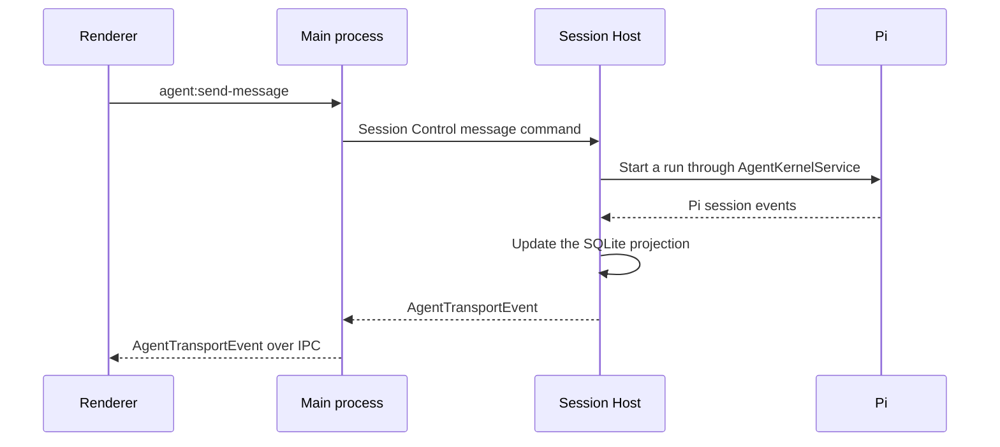

Pi is the coding-agent runtime inside OpenWaggle. It runs the model conversation, executes tools, and compacts context. OpenWaggle adds the desktop app, coordinates sessions, asks for permissions, and connects integrations. The source pins the Pi version in the `pi-runtime` catalog under `workspaces.catalogs` in the root `package.json`.

This page is for developers who want to trace what an agent does or extend the app. You do not need to set up Pi separately to use OpenWaggle. For everyday use, start with [Conversations and tools](/docs/using-openwaggle/chat-and-tools). To add runtime behavior, see [Pi extensions](/docs/extending/pi-extensions).

## Follow a message through the app

When you send a message:

1. OpenWaggle finds the project's active session and the selected provider-qualified model.
2. The main process sends a `message` command to the Session Host over its `session-control-v2` protocol. The Session Host calls the `AgentKernelService` port.
3. The Pi adapter creates Pi services for the project.
4. Pi runs the turn with its own session, model, sign-in, tool, and compaction behavior.
5. OpenWaggle translates Pi's session events into `AgentTransportEvent` values, which carry no Pi types, for the renderer.
6. The SQLite projection stores the session's nodes and branches and the data the UI reads.

Here is the same path across the processes, for a message that starts a run:

If the session already has a run, or follow-ups waiting, the Session Host queues the message as a follow-up instead of starting a run.

Pi executes the tools enabled for the run. OpenWaggle shows their events in the transcript and applies its own session rules through the Pi adapter.

## Where session files live

Each OpenWaggle session is an ordinary Pi session file, kept where the `pi` command keeps its own. By default that is `sessions/` in Pi's [agent folder](/docs/reference/data-locations#pi-agent-folder), `~/.pi/agent/sessions/`, with one folder per working directory. `PI_CODING_AGENT_SESSION_DIR`, or the `sessionDir` setting in the project's `.pi/settings.json` or in the global Pi settings, moves them. [Environment variables](/docs/reference/environment-variables#pi) lists the Pi variables OpenWaggle reads.

The SQLite projection is a read model built from the session file. The file is the record, and the projection is a copy shaped for the UI.

## Sessions started outside OpenWaggle

The Session Host also lists Pi sessions that other programs, such as the `pi` command, created in an OpenWaggle project or in a folder inside it.

Every few seconds it looks in the session folders for files it does not know yet. It reads only the start of each file: the header, an early `/name`, and the first user message. Pi writes the whole system prompt, with every tool schema, before the first user message, so when the first 64 KiB hold no user message, the Session Host reads further, up to 4 MiB. It finds the header the way Pi does, skipping blank or malformed lines for up to 1 MiB. It does not read a file again until the file changes.

A few limits keep this cheap:

- A file written in the last few seconds waits for the next pass.
- One pass lists at most 100 sessions.
- If OpenWaggle cannot create a session for a file, for example because the project's settings file is broken, it tries again after a minute, then less often.
- While a project is being removed, discovery leaves it alone.

OpenWaggle projects a listed session the first time you open it. It remembers the size and modification time of the file each projection came from. Before it shows a session, reads it through the `hive` tool, or continues it, one `stat` tells it whether another program changed the file. If the file changed, OpenWaggle reads it again. Nothing locks the file between programs, so use one program at a time.

The [Pi CLI sessions guide](/docs/using-openwaggle/pi-cli-sessions) explains what you see: titles, the question before you continue, and what deleting does. Underneath:

- Viewing a listed session never changes its file. The projection, the context meter, and other reads load the file's entries into memory and load no extensions.
- A run continues the file through Pi, the way `pi --resume` would. A file in an older Pi format moves to Pi's current format the first time you continue it. The run works in the folder the session ran in, when that folder is inside the project, with the model and thinking level `pi --resume` would pick. That means the branch's last model and last thinking level. A branch that never set a level uses Pi's `defaultThinkingLevel` for the session's folder, from the project's `.pi/settings.json` before the global one, limited to the levels the model supports.
- The composer asks before it continues a session whose latest prompt has no `openwaggle-user-input` record before it, which is the record OpenWaggle writes for its own prompts. OpenWaggle saves a remembered answer per project in your own settings, as `piSessionContinuationByProject`.
- A session listed before it had a first message takes its title once it has one.
- A fork made with the `pi` command copies the entry ids of the session it came from, and OpenWaggle stores the nodes of every session under one key. So the projection stores a listed session's entries under ids prefixed with its session id, and translates them back whenever it hands an entry to Pi.
- Deleting a listed session marks its file as dismissed, so discovery does not list it again. Removing the project deletes its sessions from OpenWaggle but dismisses none of their files, so they come back if you add the folder again.

Forking a listed session never opens its file for writing. Pi branches from a copy of it in memory, and OpenWaggle writes the fork's file next to the source before the fork's session starts. Extensions see the files like this:

| Event | What the extension sees |
| --- | --- |
| `session_before_fork` | `ctx.sessionManager.getSessionFile()` is the source |
| `session_shutdown` of the source session | `targetSessionFile` is also the source, not the fork. Pi reports the file the in-memory copy names, and the fork has no file yet |
| The fork's `session_start` (`reason: "fork"`) | `previousSessionFile` is the source. `ctx.sessionManager.getSessionFile()` and `getSessionId()` are the fork's own, and anything the fork's session appends from then on, such as `appendEntry`, goes to the fork's file |

## Tools the agent gets

Pi's default coding tools are `read`, `bash`, `edit`, and `write`. OpenWaggle also shows Pi's search and listing tools, `grep`, `find`, and `ls`, when Pi enables or emits them. Pi documents its default tool controls in the [coding-agent README](https://github.com/badlogic/pi-mono/blob/main/packages/coding-agent/README.md#tool-options).

OpenWaggle adds its own tools:

| Tool | What it does | Declared |
| --- | --- | --- |
| `hive` | Starts and coordinates worker sessions | From the first request |
| `powershell` | Runs PowerShell. Windows only, the one platform where Pi's PowerShell tool runs | From the first request |
| Browser preview controls | Drive the session's [browser preview](/docs/developer-workflow/browser-preview) | On demand |
| `project_actions` | Lists saved actions and discovered tasks, and starts, inspects, reads the output of, or stops the same managed runs the Session Summary shows | On demand |
| `source_control` | Explains how OpenWaggle reaches GitHub or GitLab for the project | On demand |
| `openwaggle_docs` | Lists, searches, and reads the docs installed with the app: these OpenWaggle docs, the Pi docs, and the docs of OpenWaggle extensions enabled for the project | On demand |

An on-demand tool is not declared to the model until Pi's `tool_search` loads it. Codemode scripts can call it at any time, and one short rule in the system prompt tells the agent it exists. So these tools cost almost no context until the agent uses them. MCP tools reach the agent through codemode in the same way. See [MCP](/docs/configuration/mcp#choose-how-tools-reach-the-agent).

A few more details:

- `openwaggle_docs` also replaces Pi's list of its own documentation paths, so the agent answers questions about OpenWaggle without guessing file paths.
- The `hive` tool declares the actions agents use most. `hive({ action: "help" })` lists every action with its parameters and the full Hive rules. OpenWaggle cuts a result longer than 32 KB to one page and saves the whole result to the session's scratch directory.
- The shell tools get the session's prepared environment and the real project and worktree paths. [Environment variables](/docs/reference/environment-variables#set-for-agent-shell-commands) lists what OpenWaggle sets for them.
- An [agent definition](/docs/extending/agent-definitions) can narrow the tools with an allowlist. An allowlist that names an on-demand tool, such as `project_actions`, declares it from the first request. So the tools can differ from one session to the next.

New runtime tools should use Pi's extension APIs, behind OpenWaggle's adapter boundaries.

## MCP

MCP runs on Pi's built-in MCP extension. Pi's SDK sessions do not load built-in extensions, so OpenWaggle adds Pi's MCP, codemode, and tool-search extensions to every session it creates. It also supplies the extension's plug-in points: the configuration files it reads, the transports it connects with, the store for sign-ins, how the sign-in page opens, and where changes are saved.

Underneath Pi's MCP client, OpenWaggle keeps each session's server connections open between messages, answers server requests for sampling and input, and serves MCP Apps. Every MCP call and codemode child call passes through Pi's `tool_call` hook, which is where OpenWaggle asks for approval. See [Model Context Protocol](/docs/configuration/mcp) for what users see, and `docs/mcp-runtime.md` in the repository for the internals.

## Context and compaction

The context meter reads Pi's `session.getContextUsage()`. Manual compaction calls Pi's `session.compact(customInstructions)`, and you can ask for it from the message box with `/compact`. The Session Host coordinates compaction, so reconnecting the UI does not start a second one.

For the controls you see and their tradeoffs, see [Context management](/docs/using-openwaggle/context-management). Pi's [SDK guide](https://github.com/badlogic/pi-mono/blob/main/packages/coding-agent/docs/sdk.md#agentsession) and [compaction guide](https://github.com/badlogic/pi-mono/blob/main/packages/coding-agent/docs/compaction.md) explain Pi's side.
