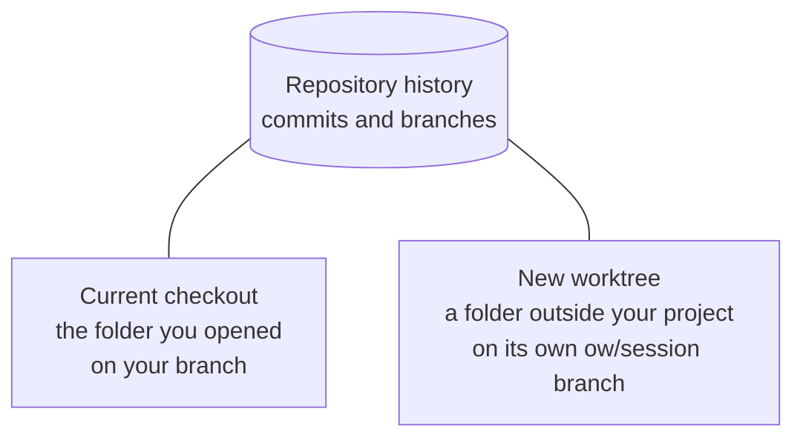

A project is a folder you open in OpenWaggle, and a session is a conversation about work in that project. Before a session's first message, you choose where it works: in the folder you opened, or in a separate Git worktree that OpenWaggle creates for it. Use your current checkout for a small change on the branch you already have. Use a worktree when you want the agent's edits kept apart from your own, or several agents working at once without touching each other's files.

## Choose where a session works

The row above the message box has two controls. The left one picks the environment, **Current checkout** or **New worktree**. The right one picks the branch. They are separate, so changing the environment never changes the branch you chose.

Both are editable until you send the first message, and read-only after that. To work somewhere else, start another session. New sessions start with the default from **Settings > Worktrees**, which is **Current checkout** unless you change it.

Your checkout and a worktree are two folders on two branches, backed by one repository:

A worktree keeps working files apart. It is not a security sandbox, and it does not limit what commands can reach on your machine.

## Work in your current checkout

Choose **Current checkout** to use the folder you opened. The agent reads and changes the same files you see in your editor and terminal, so review or save unrelated work before you send.

Before the session's first agent run, OpenWaggle tries `git pull --ff-only` from the branch's upstream. A successful pull updates your checkout. If the pull fails, the task starts anyway with the files you have. Later turns do not pull again.

Two sessions in the same checkout share its files and its branch. Separate conversations do not keep their edits apart.

## Give a session its own worktree

A Git worktree is another checkout of the same repository, in its own folder, with its own files and checked-out branch. It shares the repository's history.

1. Start a new session in your project.
2. Choose **New worktree** above the message box.
3. Pick a base branch in the branch control next to it. Uncommitted changes in your checkout are not copied into the worktree.
4. If the project has several setup profiles, choose one for this worktree.
5. Send your first message. OpenWaggle creates the worktree and its branch, then starts the agent.

Until a base branch is picked, sending stops with:

> Select a base branch before sending in worktree mode.

When the base is a local branch, OpenWaggle first tries to fetch it from `origin`. It starts from `origin/<branch>` when your local branch is the same as it or behind it. A local branch that is ahead or has diverged keeps its own tip. If the fetch fails, OpenWaggle uses the branches it already has, so you do not need a network connection. A remote branch you picked, such as `origin/main`, is used as it is.

OpenWaggle creates each worktree in a folder outside your project, on a branch named `ow/session-<ID>`, where the ID is that of the session that created it. The folder is named after the workspace ID, which in practice is the same value. Several sessions can share one workspace. Worktrees that already exist keep the names they were created with. [Data locations](/docs/reference/data-locations#managed-worktrees) lists where the folders live, and **Session Summary > Environment** shows a session's real path and branch.

See [Push a session branch](/docs/developer-workflow/git-integration#push-a-session-branch) for where the branch goes when you push it.

## Watch the worktree being created

When the first message creates a worktree, the conversation lists each step as it starts, before the agent runs:

1. **Preparing the session worktree** finds the base branch and the folder to use.
2. **Pulling latest** followed by the branch name, **from origin**, fetches a local base branch when there is one to fetch.
3. **Creating worktree** followed by the new branch and its base runs the Git command.
4. **Running project setup** appears only when the project has setup to run.
5. **Starting task** sends your message to the agent.

A finished step gets a check mark, and the running one a spinner. Until the first step or the agent reports, the conversation shows **Starting session**.

While Git creates the worktree, the conversation shows a **Creating a worktree** card with **More details**, **Work locally** and **Cancel**:

- **Work locally** stops the setup, switches the session to your current checkout, and sends the same message there once. The agent can then change your existing files.
- **Cancel** removes the message from the conversation and puts its text, attachments, skill and Waggle preset back in the message box.

If creating the worktree fails, the card keeps your message, adds **Retry**, and shows the Git command and its error under **More details**. Fix the problem, then retry.

A first message in **Current checkout** shows a **Starting session** card for the same wait. It shows **Pulling latest changes for** and the branch name when the branch tracks an upstream. It has no **Work locally**, and it disappears once the agent starts.

Once the agent starts, the worktree card shrinks to a **Worktree created** row that you can expand. The row stays in the conversation after a reload, as a record of where the session began. Sessions in your current checkout, and worktree launches you cancelled, do not get one.

Expand **Worktree created** to see what each step did, such as the branch it fetched and the branch it created.

## Run setup in a new worktree

A project can have setup commands, such as installing dependencies, that run in each new worktree after Git creates it. The conversation shows this step as **Running project setup**. Setup must succeed before the agent's first turn.

If setup fails or is waiting for your review, open **Session Summary > Workspace preparation**. Read the output, then choose **Retry setup**, **Check the setup**, or **Continue anyway**. A session in your existing checkout runs setup only when you choose **Run setup** there. Keep development servers as project actions, not setup commands. The Project actions guide explains [how to configure setup](/docs/configuration/project-actions#run-setup-for-a-new-worktree).

## Check where work is happening

After the first message, open the **Session Summary** and look at **Environment**. The diff panel, Git actions and new terminals all use that session's working directory.

A terminal you opened before the worktree existed stays in your original checkout and is labelled **Original checkout**. Open a new terminal for the worktree, or choose **Restart in worktree** to stop that shell and start it again in the worktree.

## Recover a missing worktree

If a session's worktree was deleted outside OpenWaggle, OpenWaggle stops you from sending rather than quietly picking another folder. A fresh checkout would not have the session's uncommitted work. The message box shows:

> This session's worktree no longer exists. Recreate it, or switch this session to the current checkout.

Choose one of the two actions on that row:

- **Recreate worktree** makes a new worktree on the session's existing branch, so its commits come back. It cannot bring back uncommitted files that were deleted with the old worktree. The worktree keeps its setup profile, but setup runs again, because the old setup results and their environment values belonged to the deleted folder.
- **Use current checkout** moves the session to the folder you opened.

## Manage worktrees

Open **Settings > Worktrees** to see how much space session worktrees take and to remove them, either by hand or automatically once their sessions have been archived for a while. Archiving a session keeps its worktree. Removing a worktree keeps its branch but deletes the folder, including ignored files. Worktrees live outside your project, in the folder listed under [Data locations](/docs/reference/data-locations#managed-worktrees).

If the project has cleanup commands, they run before the worktree is removed, after the last session using it lets go of it and its project actions have stopped. If cleanup fails, OpenWaggle keeps the worktree and offers **Retry cleanup** or **Delete anyway**. Deleting anyway can leave things such as temporary databases behind.
