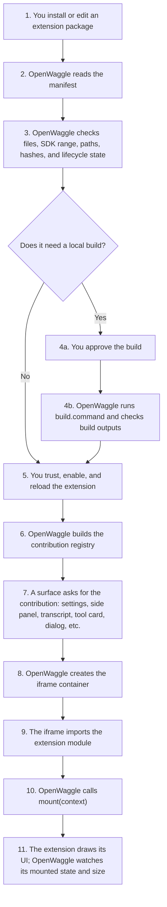
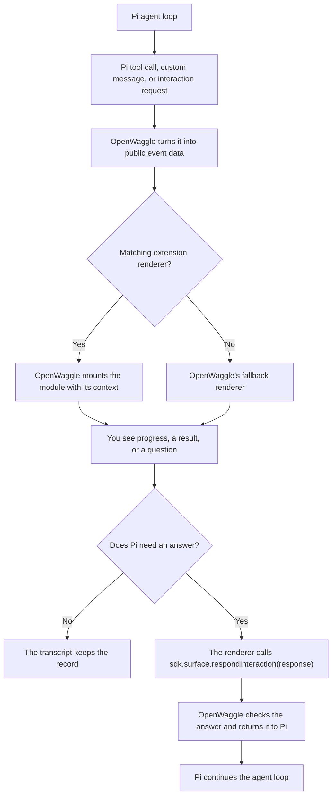

An OpenWaggle extension is a local package that adds desktop UI, commands, or agent tools to the app. Build one when you need a settings page, a side panel, a custom card for a tool's results, or a tool the agent can call. The package is a folder with a manifest and the code files the manifest lists. If you only want reusable instructions and no new code, write a [skill](/docs/extending/skills-system) instead, and if you want to use a package someone else wrote, see [Install extensions](/docs/extending/plugins).

This guide walks you through a first extension and the jobs that come after it. The exact manifest fields, limits, capabilities, and SDK calls are in the [extension manifest reference](/docs/extending/extension-manifest). To add rows to the floating Session Summary, or to publish sources and outputs, see [Add to the Session Summary](/docs/extending/extension-session-summary).

An extension works inside the contract the installed OpenWaggle offers. Declaring a capability OpenWaggle does not have does not add it. That takes an OpenWaggle update. See [Know when you need an OpenWaggle update](#know-when-you-need-an-openwaggle-update).

## Create a basic extension

A basic extension is a folder with an `openwaggle.extension.json` manifest and one or more code files. For an extension that only one project uses, put the folder in the project:

```text
my-project/
  .openwaggle/
    extensions/
      example-extension/
        openwaggle.extension.json
        package.json
        src/
          settings.js
          side-panel.js
        modules/
          settings.js
          side-panel.js
        docs/
          README.md
```

The folder name must match the manifest's `id`. A global extension lives in the `extensions/` folder of OpenWaggle's [app data folder](/docs/reference/data-locations#what-is-in-the-app-data-folder) instead. A global extension can affect every project where it is enabled, so manage it through **Settings > Extensions** or through the approved package workflow described in [Let an agent write an extension](#let-an-agent-write-an-extension).

Write the manifest first. This one adds a settings section, a side panel, and a Session Summary section, and asks for project storage:

```json
{
  "manifestVersion": 1,
  "id": "example-extension",
  "name": "Example Extension",
  "version": "0.1.0",
  "description": "A small extension with settings and a side panel.",
  "sdk": {
    "openwaggle": ">=0.1.0 <0.2.0"
  },
  "sourceFiles": ["package.json", "src/settings.js", "src/side-panel.js"],
  "builtArtifacts": ["package.json", "modules/settings.js", "modules/side-panel.js"],
  "install": {
    "source": "prebuilt"
  },
  "capabilities": [
    {
      "id": "openwaggle.storage",
      "methods": ["get", "set", "list"],
      "scopes": ["project"]
    }
  ],
  "contributions": {
    "settingsSections": [
      {
        "id": "example.settings",
        "title": "Example Settings",
        "runtime": "federated-module",
        "execution": "host-renderer",
        "entry": "modules/settings.js",
        "capability": "openwaggle.storage",
        "methods": ["get", "set", "list"]
      }
    ],
    "sidePanels": [
      {
        "id": "example.panel",
        "title": "Example Panel",
        "icon": "ticket",
        "runtime": "federated-module",
        "execution": "host-renderer",
        "entry": "modules/side-panel.js",
        "capability": "openwaggle.storage",
        "methods": ["get", "list"]
      }
    ],
    "sessionSummarySections": [
      {
        "id": "example.session-summary",
        "title": "Example Session Status",
        "placement": "details",
        "rows": [
          { "id": "status", "label": "Status", "value": "Ready" },
          {
            "id": "open-details",
            "label": "Open details",
            "action": { "family": "sidePanels", "contributionId": "example.panel" }
          }
        ]
      }
    ]
  }
}
```

The manifest is the whole contract. OpenWaggle reads it before it runs any of your code, and anything it does not declare, whether a contribution, capability, file, network origin, runtime requirement, or build step, is not available at run time.

Then build or copy the entry modules listed in `builtArtifacts`. Each visual entry module exports a `mount(context)` function. It adds its UI to `context.root` and can return a cleanup function:

```js
export async function mount(context) {
  const root = document.createElement('section')
  root.textContent = `Mounted ${context.contribution.id}`
  context.root.append(root)

  return () => {
    root.remove()
  }
}
```

## Load it in OpenWaggle

1. Open **Settings > Extensions** and click **Refresh**, so OpenWaggle finds the new package.
2. Check what the package card shows: the package path, SDK range, content hash, install source, build command, capabilities, network origins, trusted local code, runtime requirements, docs topics, Pi resource folders, and any diagnostics.
3. If the package has a local build, approve and run it with **Approve and build**. See [Add a build step](#add-a-build-step).
4. Click **Trust**. Trust records the package as it is now: its version, SDK range, the permissions you granted, and its content hash.
5. Click **Enable**.
6. Click **Reload**, so the extension's contributions appear where they belong.

When you develop a project extension by hand, you can put the files straight into `.openwaggle/extensions/<extension-id>/`. Only the package files belong to the project, though. Trust, enablement, build approval, permission grants, project opt-outs, and extension storage stay with you, on your machine, and are never committed with the package.

A contribution shows up only once every check passes: the manifest is valid, its files exist, the SDK range matches, the content hash matches what you trusted, any required build succeeded, the extension is trusted, enabled, and reloaded since its last change, and the current project has not opted out. The [manifest reference](/docs/extending/extension-manifest#readiness-checks) lists these checks.

## Choose where your extension appears

Choose where the extension shows up by what it does, not by the framework you render it with. It can add a settings section, a side panel, a dialog, a route, a command, a renderer in the transcript, a status widget or a Session Summary section, and one extension can add several of them. Those parts can share package state, while the transcript keeps the record of what the agent did.

- `settingsSections` hold configuration, account setup, feature switches, and diagnostics. They read and write settings through SDK capabilities.
- `sidePanels` hold content that stays open while you work, such as issue lists, project details, logs, or state shared with the extension's other contributions.
- `dialogs` are modals that OpenWaggle draws: confirmations, pickers, and forms that briefly interrupt what you are doing.
- `routes` are larger views inside an OpenWaggle route container. They do not replace the app's navigation.
- `commands` and `slashCommands` start actions from the slash command menu or the composer. In the composer they are compact launchers or selectors, never controls inside the text box.
- `transcriptRenderers` draw Pi session records in the transcript. They must be able to draw a record again from the mount context and the Pi session data after a remount or a restart.
- `toolRenderers` draw Pi tool calls and their results. They change how a Pi tool looks in the app. They do not add a second tool system.
- `customMessageRenderers` draw Pi custom messages, matched by Pi's custom message type.
- `interactionRenderers` collect your answer when a Pi tool asks something, such as `confirm`, `select`, `input`, `editor`, `notify`, or a custom interaction, and send the typed answer back through the SDK.
- `statusWidgets` are small status displays for live progress, connection state, or the extension's own indicators.
- `sessionSummarySections` add rows to the Session Summary of the session you have open. See [Add to the Session Summary](/docs/extending/extension-session-summary).

OpenWaggle owns each container: where it goes, its frame, size, docking, what shows when the extension fails, and what it remembers. Your extension owns what it draws inside. Extensions add to OpenWaggle's screens. They cannot replace the main layout or the global navigation, and they cannot install themes for the whole app.

The [development fixture](#test-with-the-development-fixture) uses most of these. Once trusted, enabled, and reloaded, its **GitHub Issues Overview** side panel opens from its icon on the Panel rail, with **Extension side panel** in the header above the panel's title. The icon of its second side panel carries a dot until you open that panel or **All panels**. A **GitHub Issues Transcript Summary** card sits at the end of the transcript, and the **GitHub Issues Status** widget sits above the composer. Settings sections do not appear here. They are in **Settings > Extensions**, under **Extension settings** (see [Install extensions](/docs/extending/plugins#review-and-enable-a-package)).


### Give a side panel an icon

A side panel can set `icon`, which OpenWaggle shows on the Panel rail and in **All panels**. Use a [Lucide](https://lucide.dev/icons/) icon name in kebab-case, such as `"ticket"` or `"git-pull-request"`, or point to an SVG file in your package:

```json
{
  "sidePanels": [
    {
      "id": "example.board",
      "title": "Board",
      "icon": { "svg": "assets/board.svg" },
      "runtime": "federated-module",
      "execution": "host-renderer",
      "entry": "modules/board.js"
    }
  ]
}
```

OpenWaggle uses only the shape of the icon and paints it in the rail's own colors, so it ignores colors and gradients in the file. Draw one shape in a single color on a transparent background, with a `viewBox`. 24 × 24 matches Lucide. Keep the file under 32 KiB. The SVG file is package content, so editing it changes the package's content hash.

If the icon is missing, names an unknown Lucide icon, or points to a file OpenWaggle cannot use, the panel shows a tile with the first letter of its title. **Settings > Extensions** then lists a `panel-icon-invalid` warning under the contribution registry diagnostics. The [manifest reference](/docs/extending/extension-manifest#side-panel-icons) has the path rules and what OpenWaggle strips from an SVG.

## Write the mount function

Visual contributions use the `federated-module` runtime. Your entry module exports `mount(context)`, and you can build the UI with React, Vue, Preact, Svelte, plain DOM, or anything else. The contract is the mount context, not a framework. OpenWaggle may load the module with module federation, import maps, versioned runtime URLs, or another loader, but your entry point stays the same.

`mount(context)` receives everything your contribution should use:

- `context.root` is the element to add your content to.
- `context.extension` and `context.contribution` name the package and the mounted contribution: ids, name, version, title, and family.
- `context.surface` carries data for the surface, such as the settings section, the side panel container, the transcript record, the tool event, or the pending question.
- `context.sdk` makes the calls the manifest allows: package storage, OpenWaggle state, actions, settings, docs lookup, registering contributions at run time, and surface calls such as sending an action or answering a question.
- `context.theme` holds OpenWaggle's theme tokens, with CSS-variable-shaped values for color, typography, spacing, radius, focus, and shadow.

Style your content with `context.theme` instead of importing OpenWaggle's CSS or hard-coding app colors. OpenWaggle owns the token values and changes them for your settings, high-contrast modes, and future themes. Keep your styles scoped to your own content.

The mount context is also the safety boundary. Your module asks for actions through `context.sdk`. It must not import OpenWaggle's stores, renderer code, Electron IPC helpers, or Pi SDK internals. A `trusted-renderer` contribution is no exception. OpenWaggle mounts it in the same sandboxed extension frame, and it gets the same SDK and context.

### Use the optional helper modules

`mount(context)` is all you need, but OpenWaggle also publishes typed helpers that import no framework:

- `extension-sdk` has the SDK factory, result types, storage helpers, helpers for OpenWaggle state, actions, settings, and docs, and the `OpenWaggleExtensionMountContext` and `OpenWaggleFederatedModule` types.
- `extension-theme` has the theme tokens, CSS variable names, fallback tokens, and helpers that turn theme values into CSS.
- `extension-ui` has class names, data attributes, a helper that joins class names, and a small stylesheet generator built from OpenWaggle's theme variables.

They are plain TypeScript and DOM helpers, with no React, React DOM, Zustand, renderer, Electron IPC, or Pi SDK imports. If your extension uses them, bundle them into your built files, or load them through the author-module mechanism OpenWaggle offers for the installed SDK version. Never import source paths from an OpenWaggle checkout at run time in an extension you distribute.

This plain DOM example uses the published `@openwaggle/extension-sdk/ui` export:

```js
import {
  createOpenWaggleExtensionUiStylesheet,
  OPENWAGGLE_EXTENSION_UI_CLASS_NAMES as ui,
} from '@openwaggle/extension-sdk/ui'

export async function mount(context) {
  const style = document.createElement('style')
  style.textContent = createOpenWaggleExtensionUiStylesheet({
    theme: context.theme,
  })

  const panel = document.createElement('section')
  panel.className = `${ui.root} ${ui.panel} ${ui.stack}`

  const heading = document.createElement('h2')
  heading.className = ui.heading
  heading.textContent = context.contribution.title

  const body = document.createElement('p')
  body.className = ui.text
  body.textContent = `Mounted for ${context.extension.name}`

  panel.append(heading, body)
  context.root.append(style, panel)

  return () => {
    style.remove()
    panel.remove()
  }
}
```

Install a compatible SDK version and bundle the helper code into your extension. An extension you distribute must not depend on internal aliases from an OpenWaggle checkout. Whether your extension runs still depends only on the mount context and the SDK capabilities.

For install commands, entry points, and more import examples, see [Packages](/docs/packages/overview), in particular [`@openwaggle/extension-sdk`](/docs/packages/extension-sdk) and [`@openwaggle/extension-react`](/docs/packages/extension-react).

## Show something right away

OpenWaggle decides whether your extension may appear and where, makes and sizes its container, and checks which calls it may make. Your extension decides what to draw inside `mount(context)`:



The contribution registry is the list of contributions the app can use right now. A contribution that is not in it is unavailable, and the UI shows OpenWaggle's own fallback where there is one. Being in the registry is not the same as being mounted. A contribution is in the registry once OpenWaggle allows it. It is mounted once the iframe has loaded the module and `mount(context)` has resolved.

OpenWaggle shows a generic loading state only until `mount(context)` resolves. So if your extension fetches data, reads storage, or calls a network API, draw a light shell or skeleton first and do the slow work after that first render.

An extension can be slow to appear when:

- it is not trusted, enabled, or reloaded yet
- it needs a local build
- it changed and is waiting for update approval
- OpenWaggle has many extension folders or project scopes to search
- the module is large or imports a large UI framework
- it does slow work inside `mount(context)`, or fetches network data
- the app runs in development mode, with Vite and Electron rebuilds or a main process still holding an old CSP

A prebuilt module that draws from cached state needs no build and no network request while it mounts.

## Add a build step

Most extensions ship JavaScript that is already built, listed in `builtArtifacts`, and never compile while they render. If yours needs a build on the user's machine, declare it:

```json
{
  "install": {
    "source": "local-build"
  },
  "build": {
    "command": "pnpm build",
    "outputs": ["dist/index.js"]
  },
  "builtArtifacts": ["dist/index.js"]
}
```

A local build runs only when the user asks for it:

- The user approves the build with **Approve and build** before OpenWaggle runs it. Approving the build is separate from trusting the extension.
- The command runs in the extension's package folder, for up to 10 minutes.
- OpenWaggle keeps the build status and the last 4,000 characters of the build log.
- List build outputs in `builtArtifacts` too.
- A failed build keeps the extension from being trusted or enabled for use.
- Changing source files changes the build plan's hash, so the build needs approval again.

The build takes as long as your build command does. Drawing the extension never runs the build again.

## Show Pi tools and questions

Agent behavior stays in Pi. Use Pi's extension APIs for tools, runtime resources, session hooks, and questions to the user, and use OpenWaggle contributions to draw them in the app. OpenWaggle does not have a tool system of its own.

The Pi APIs extensions use most:

- `pi.registerTool()` registers a tool the model can call.
- `renderCall` and `renderResult` draw a tool in Pi's terminal UI.
- `pi.registerMessageRenderer()` draws custom messages in Pi's terminal UI.
- `ctx.ui.confirm()`, `ctx.ui.select()`, `ctx.ui.input()`, `ctx.ui.editor()`, `ctx.ui.notify()`, and `ctx.ui.custom()` ask the user something.
- `ctx.ui.setStatus(key, text)` and `ctx.ui.setWorkingMessage(text)` set status text, which OpenWaggle shows on the run's status row while the run is running or finishing. Pass `undefined` to clear it. Each run starts with no status text.

An `agent_before_settle` handler runs after the agent's last answer, while the run shows "Finishing". If the handler takes more than a moment, **Stop** appears next to "Finishing". Pressing it aborts `ctx.signal`, so a slow check should stop when that signal aborts. If the handler ignores the signal, OpenWaggle ends the run a few seconds after **Stop** anyway.

OpenWaggle's desktop renderers match Pi's own names: tool names, custom message types, standard interaction kinds, and custom interaction types. So Pi's terminal UI and the OpenWaggle app draw the same event.

### Draw a tool call

A renderer can only show progress, like a tool progress card, or it can ask for something, like an approval dialog. Match it to a Pi name. This one draws the fixture's `openwaggle.github.listIssues` tool:

```json
{
  "contributions": {
    "toolRenderers": [
      {
        "id": "github.issue-tool-card",
        "title": "GitHub Issues Tool Card",
        "runtime": "federated-module",
        "execution": "host-renderer",
        "entry": "dist/github-issue-tool-card.js",
        "matches": {
          "toolNames": ["openwaggle.github.listIssues"]
        },
        "capability": "openwaggle.storage",
        "methods": ["get", "list"]
      }
    ]
  }
}
```

One Pi tool or custom message can have several renderers on different surfaces. The transcript keeps the record. Dialogs, side panels, status widgets, and composer actions are extra live views.

### Answer a question from Pi

When a Pi tool asks the user something, the answer goes back through OpenWaggle, never straight from your UI to Pi:



Your renderer collects the answer and calls `context.sdk.surface.respondInteraction(response)`. OpenWaggle checks the answer against the pending question before it gives it to Pi. Renderers never change Pi sessions or OpenWaggle's stores directly.

The standard questions, `confirm`, `select`, `input`, `editor`, and `notify`, always have OpenWaggle's own UI as a fallback, so a tool never hangs when your renderer is missing. To draw one of them yourself, list it in `matches.interactionKinds`. For a standard question, the answer must match its public schema, for example `{ "kind": "confirm", "accepted": true }`.

`custom` is for questions that do not fit the standard ones. OpenWaggle does not run Pi's terminal UI components inside Electron, so a custom question needs a desktop renderer whose `matches.interactionKinds` names its `customType`. Without one, OpenWaggle shows an unsupported-question fallback with a reject button, so the tool does not wait forever. The value your renderer sends back becomes the custom question's result. The [manifest reference](/docs/extending/extension-manifest#interaction-kinds) lists what each kind shows.

Renderers receive OpenWaggle's public event data, not Pi package types or OpenWaggle internals. The data keeps Pi's meaning: tool name, custom message type, ids, inputs, partial and final results, details, errors, and the session and project. The [manifest reference](/docs/extending/extension-manifest#event-data) lists the fields.

## Share state between surfaces

Extensions never import OpenWaggle's writable stores, renderer internals, Pi SDK internals, or Electron internals. They read and change things only through SDK calls the manifest allows:

- Read OpenWaggle state with `openWaggle.state.get(scope)`.
- Change it with action calls such as `openWaggle.actions.selectProject(scope, projectPath)`.
- Read and change settings with `openWaggle.settings.get(scope)` and `openWaggle.settings.update(scope, settings)`. The model preferences report Pi's global default thinking level as `thinkingLevel`, but an update cannot set it. The thinking level belongs to each session, and only the user changes it.
- List and publish the open session's sources and outputs with `openWaggle.resources`. See [Add to the Session Summary](/docs/extending/extension-session-summary#publish-sources-and-outputs).

For your own data, use storage:

- Package state, in `storage.packageState.global` and `storage.packageState.project`, survives restarts and every contribution of the package shares it. Use it when settings, side panels, renderers, and status widgets of one extension need to agree.
- Package configuration, in `storage.packageConfig.global` and `storage.packageConfig.project`, works the same way.
- Instance state belongs to one mounted contribution. Use it for passing UI details, such as the focused tab, expanded rows, or a half-filled form.

The Pi session data stays the record of what the agent did. A transcript renderer must be able to draw an old entry again from the mount context and the Pi session data alone, after a remount, a route change, or an app restart. Never make that depend on instance state.

## Add contributions while the extension runs

The manifest is the simplest way to declare contributions. Your code can also add and remove contributions without an app restart, with `context.sdk.runtime.registerContribution(scope, registration)` and `context.sdk.runtime.unregisterContribution(scope, unregistration)`.

To do this, the manifest must declare the `openwaggle.runtime` capability with `register-contribution`, `unregister-contribution`, or both. It must also declare each contribution family your code will use, even as an empty array.

A registration uses the same schema as the manifest. It cannot ask for capabilities, methods, or scopes the manifest does not declare. It cannot replace or remove a contribution the manifest declares. A registration in project or session scope stays in that scope, so a contribution registered for one project never shows up in another. Branch scope is not supported yet, and a branch-scoped registration fails.

A side panel registered this way can use a Lucide icon, or an SVG file that a side panel in the manifest already uses. Only SVG files the manifest declares count toward the content hash, so a registration that names any other SVG file fails, as does one whose `icon` does not match the icon schema.

## Update, disable, or remove an extension

To update an extension, replace the package with the new version and raise its `version`. OpenWaggle sees that the content hash changed and treats it as an update. Approve it with **Approve update**, then enable and reload the extension again if the update turned it off. An update never swaps in silently. Editing the manifest, source files, built files, or the build plan all change the hash.

To stop an extension without deleting it, click **Disable** in **Settings > Extensions**. OpenWaggle removes all its contributions, closes its sandboxed frames and runtime subscriptions as their surfaces unmount, blocks its module access, and marks it as not reloaded. For a global extension, use the project availability controls to turn it off in one project only.

To delete an extension, click **Remove** and confirm. OpenWaggle removes its contributions, ends its runtime and module access, deletes its trust and enablement records, and deletes the package folder:

- A project extension's folder is `<project>/.openwaggle/extensions/<extension-id>/`.
- A global extension's folder is `extensions/<extension-id>/` in the app data folder, and removing it needs a second confirmation because it affects every project.

Removing an extension keeps the data it stored. Deleting that data should be a separate choice the user makes.

Agents must never delete an extension's folder directly. An agent proposes the removal, the user approves that exact extension id and scope, and then the agent calls OpenWaggle's remove workflow. That way OpenWaggle cleans up before the files disappear.

## Let an agent write an extension

Agents can help write project or global extensions, but writing package files is not an SDK capability. Extension code cannot change another extension's package. Instead, OpenWaggle runs the workflow:

1. The agent proposes the package id, scope, operation (`create`, `update`, or `remove`), manifest, permissions, build plan, and full file list.
2. OpenWaggle shows the proposal with the operation, the file paths, each file's content hash and size in bytes, the proposal hash, and whether global-impact confirmation is needed. The proposal hash covers the operation, extension id, scope, file paths, and file contents.
3. You review the proposal and approve that exact hash.
4. For a global package, you also confirm the global impact, because the package can affect every project where it is enabled. This second confirmation is tied to the same proposal hash and the `global-extension-package-write` risk marker.
5. OpenWaggle writes, replaces, or removes the package, then refreshes discovery and the package's state.

A `create` proposal is valid only when the package does not exist yet, and an `update` proposal only when it does. If the package changes between the proposal and your approval, OpenWaggle rejects the old proposal before writing any file.

An approved update replaces the whole package folder, so files that are not in the new proposal are deleted. The extension stays off until you review it, trust it or approve the update, enable it, and reload it again.

An approved removal shuts the extension down before OpenWaggle returns the new extension list. Its contributions leave the registry, its sandboxed modules lose access, and Pi no longer loads the package.

## Review what an extension may do

An extension is local software that you choose to trust. Finding a package never trusts it. Before you trust it, OpenWaggle reads the manifest, checks the declared files and SDK range, calculates the content hash, checks runtime requirements, and shows diagnostics. After you trust it, it still runs only while it is enabled, up to date, built, reloaded, not turned off for the project, and eligible for each surface.

The review shows what the extension may do: run visual modules, run trusted code in the main process, reach network origins, run a build script, need external programs, call SDK capabilities, and publish session resources. The extension can reach only the origins in `network.origins`, such as `https://api.github.com`. The [manifest reference](/docs/extending/extension-manifest#permissions) describes each permission and how OpenWaggle enforces it.

## Recover from a broken extension

A broken extension never stops OpenWaggle from starting.

- An invalid manifest, a missing file, an incompatible SDK range, a missing runtime requirement, a failed build, or a stale trust record becomes a diagnostic in **Settings > Extensions**, and keeps the package or contribution out of the registry.
- When one contribution fails to register, other extensions' contributions still load.
- When a contribution fails to mount, the failure stays in its own container where possible.
- Standard Pi questions keep OpenWaggle's fallback UI, so a tool does not hang when a custom renderer is missing. A `custom` question with no renderer shows an unsupported-question fallback with a reject button.
- **Disable**, **Untrust**, turning the extension off for a project, **Approve update**, **Approve and build**, and **Reload** always stay in OpenWaggle's hands, so you can always recover.

## Test with the development fixture

The GitHub Issues Overview fixture exercises the extension lifecycle and the SDK. It shows:

- settings and side panel contributions that share package state
- a Pi tool, `openwaggle.github.listIssues`
- standard Pi questions such as `confirm`
- a custom desktop question and a transcript tool renderer
- the fallback when the custom renderer is off or missing

Development fixtures live in `fixtures/extensions/`. They are for tests, demos, and local QA, and never ship in the app. To copy the fixture packages into the current checkout's `.openwaggle/extensions/` folder for QA, run:

```bash
bun run extension:qa:install
```

This is a development helper, not a packaging step.

### Run the extension host tests

From an OpenWaggle checkout, run the service and Settings component tests for the extension host:

```bash
bun run test:unit && bun run test:integration && bun run test:component
```

They cover discovery, trust, enabling, reloading, storage through the SDK, teardown, and the Settings controls. Component tests do not prove that a packaged Electron iframe loads and draws, so check that separately in the real app.

### Check it in the real app

This uses the visible debug app. Agents must not run it unless the maintainer approves that exact run.

1. Install the fixture:

   ```bash
   bun run extension:qa:install openwaggle-github-issues-overview
   ```

2. Start the visible app with the Chrome DevTools Protocol:

   ```bash
   bun run dev:debug:headed
   ```

3. Check that DevTools answers:

   ```bash
   curl -s http://127.0.0.1:9222/json/version
   ```

4. Open **Settings > Extensions** and click **Refresh**.
5. Trust **GitHub Issues Overview**, enable it, then click **Reload**.
6. Check that **GitHub Issues Settings** appears under **Extension settings**, and that the frame titled `Extension module: GitHub Issues Settings` shows the fixture's form.
7. Save the configuration from inside the frame, to prove that storage through the SDK works.
8. Disable the extension and check that the settings contribution disappears.
9. Remove the extension with **Remove**, and check that the package card, its registry entry, and the sandbox frame disappear. The extension's stored data stays, unless a separate data deletion option is offered.
10. Check the console for errors through the Electron QA DevTools path before you sign off.

## Ship docs with your extension

Put Markdown docs in your package's `docs/` folder and declare each one under `docs.topics` in the manifest, with an `id`, a `title`, and its `path`. OpenWaggle lists them under your extension's own namespace, such as `extension:openwaggle-github-issues-overview/configuration`, with the extension id and its trust and lifecycle state attached. Your docs can never replace OpenWaggle's or Pi's topics. The docs index and `openWaggle.docs.discover` list every extension's docs, whether or not the extension is trusted or enabled. The `openwaggle_docs` tool is stricter, as the list below says.

Agents read these docs, and the rest of the installed docs, with the `openwaggle_docs` tool:

- `list` and `search` return topic ids and details, with OpenWaggle topics first.
- `read` returns one topic's Markdown, in pages, like Pi's `read` tool.
- The tool includes docs only from extensions that the session's runs load: trusted, enabled, reloaded, and not turned off for the session's project. It reads an extension doc only while the file still sits inside the package and still matches the hash recorded when OpenWaggle found it.
- When the docs bundle loads, the tool's prompt names its folder. When it does not load, in a development checkout without `bun run docs:generate` or in a damaged install, the tool returns an error that says so, and the run continues.

Extension code can look up the same topics with `context.sdk.openWaggle.docs.discover(scope, input)` and `context.sdk.openWaggle.docs.resolveTopic(scope, input)`, if the manifest declares `openwaggle.docs` with that method and scope. Both return a topic's details, not its content. The [manifest reference](/docs/extending/extension-manifest#docs-lookup) shows what they return.

### Where the installed docs come from

These website pages are the only source of OpenWaggle's docs. `bun run docs:generate` builds `build/openwaggle-docs` from `website/src/content/docs/**` and the installed Pi package docs, and packaged builds ship that bundle. Do not keep separate hand-written copies for agents. If the installed docs are wrong, fix the build step or the page.

The bundle has a root `README.md` that says what it contains and where it came from, and a topic index that maps common questions to paths, for example extensions, tools, interactions, sessions, settings, providers, MCP, Pi runtime, and QA fixtures. OpenWaggle docs and Pi docs sit in separate, predictable groups. A tool that only has file access can use the index to find its way.

## Know when you need an OpenWaggle update

You can ship an extension on your own schedule as long as it stays within what the installed OpenWaggle supports: new or changed contributions in existing families, new `federated-module` entries that still export `mount(context)`, new assets and docs, Pi tools and resources, more use of existing SDK capabilities, and your own storage keys. Changes to network origins, build commands, or runtime requirements need the user's approval again.

You need an OpenWaggle update for anything the host itself must support, such as a new contribution family, a new runtime, a new SDK capability or method, or a new Pi question type. The [manifest reference](/docs/extending/extension-manifest#what-needs-an-openwaggle-update) has both lists in full.

If the installed app reports your `sdk.openwaggle` range as incompatible, no change to your code fixes that. Either target the installed SDK range, or the user updates OpenWaggle.

## Read Pi's docs

For exact Pi behavior, read the Pi docs installed in a checkout:

- `node_modules/@earendil-works/pi-coding-agent/docs/extensions.md`
- `node_modules/@earendil-works/pi-coding-agent/docs/rpc.md`
- `node_modules/@earendil-works/pi-coding-agent/docs/sdk.md`
- `node_modules/@earendil-works/pi-coding-agent/docs/tui.md`

OpenWaggle's docs explain how those Pi features appear in the desktop app. For Pi extensions that change agent behavior without desktop UI, see [Pi extensions](/docs/extending/pi-extensions).
