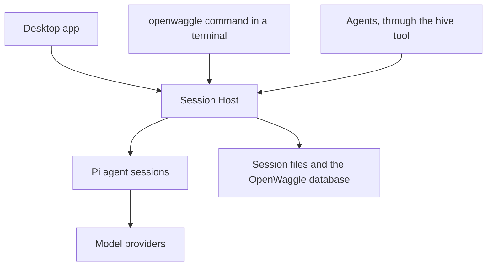

OpenWaggle is a desktop app for an AI coding agent. The agent itself is [Pi](https://pi.dev), a coding agent that you can also run on its own as the `pi` command. OpenWaggle gives Pi a window, keeps your conversations organized by project, and runs the agent in a background process so work goes on when the window closes. This page explains the pieces you meet in the rest of the docs.

## Projects

A project is a folder on your computer, usually a Git repository, that you opened in OpenWaggle. The sidebar groups everything by project. Project settings, saved actions and instructions for the agent live in the folder, in `.openwaggle/` and `AGENTS.md`, so they travel with the repository.

## Sessions and branches

A session is one conversation with the agent about a project. It holds your messages, the agent's replies and a record of every tool the agent used. You can come back to a session at any time and carry on.

Besides keeping it in its own database, OpenWaggle saves each session as a Pi session file, the same kind of file the `pi` command writes. That is why a session you start with `pi` in a project folder shows up in OpenWaggle, and why `pi --resume` can pick up a session you started in the app. See [sessions from the Pi CLI](/docs/using-openwaggle/pi-cli-sessions).

Pi stores a conversation as a tree. When you go back to an earlier message and continue from there, the old path stays in the tree and the new one becomes a branch. Only the branch you are on is sent to the model. These branches belong to the conversation and are not Git branches. The [Session Tree](/docs/using-openwaggle/session-tree) shows them.

## Runs, follow-ups and steering

A run is the agent working on one of your messages. In a run, the model replies, asks for tools such as reading a file or running a test, gets their results, and replies again, until it has nothing left to do. Then the run ends and the session waits for you.

A session has at most one run at a time. If you send a message while the agent works, it waits in the queue as a follow-up and starts its own run when the current one ends. If the message should change what the agent is doing now, choose **Steer** instead. The agent reads it in the current run, at its next step, without stopping a tool that is already running. [Conversations and tools](/docs/using-openwaggle/chat-and-tools#send-a-message-while-the-agent-works) shows both.

A session can also start other sessions to help it. A session that does this becomes a Hive's Queen, and the sessions it starts are its workers. Each worker is an ordinary session with its own conversation, and the Queen reviews what they hand back. See [Hives and sessions](/docs/using-openwaggle/hives-and-sessions). [Waggle mode](/docs/using-openwaggle/waggle-mode) is different. Two agents take turns in the same session.

## The Session Host

The agent doesn't run inside the window. It runs in the Session Host, a background process that OpenWaggle starts when it is needed. The Session Host owns your sessions, their runs and queues, and the project actions it starts for you, such as a dev server.

Everything that works with sessions talks to the same Session Host:

So you can close the app while the agent works, and the run goes on. When you reopen the app, it shows the same session, still working or finished. A terminal running `openwaggle` sees the same sessions as the window, and an agent can read or message another session through its `hive` tool. When no app or other client is connected and no work is left, the Session Host exits after 5 minutes by default. [Command line](/docs/developer-workflow/command-line) shows how to check on it and stop it, and [session recovery](/docs/configuration/session-recovery) explains what happens after a crash.

Terminal tabs and browser previews are the exception. They belong to the desktop app and close with it.

## Pi underneath

Most of what the agent can do comes from Pi:

- The providers and models you can connect, and their sign-in and API keys.
- The agent's tools, such as `read`, `edit` and `bash`, and [codemode](/docs/using-openwaggle/codemode).
- Skills, Pi extensions, and context compaction when a conversation gets long.

OpenWaggle reads your Pi setup in `~/.pi/agent`, so a model you set up for `pi` works in OpenWaggle too, and the other way round. OpenWaggle adds what a desktop app needs on top: projects, worktrees, the browser preview, Hives, approvals for protected actions, and the panels around the conversation.

## Worktrees

By default a session works in the folder you opened, its current checkout. Several sessions can share that folder, and their edits land in the same files.

To keep a session's changes apart, start it in a new worktree. OpenWaggle creates a Git worktree, a second checkout of the same repository on its own branch, under `~/.openwaggle/worktrees/`. The session's agent works there, and your folder stays as it was. You choose this before the session's first message. The message box doesn't let you change it after the first message. An agent or the CLI can still move a session with `handoff`. See [Projects and worktrees](/docs/developer-workflow/projects-and-worktrees).

## Where your data lives

OpenWaggle keeps your data on your computer, in a few places:

- The session database, with your sessions, Hives and scheduled tasks, in the app data folder: `~/Library/Application Support/openwaggle` on macOS, `%APPDATA%\openwaggle` on Windows and `~/.config/openwaggle` on Linux. Visualizations and other app files are there too.
- Pi session files, in Pi's sessions folder, `~/.pi/agent/sessions` by default.
- Pi's own setup in `~/.pi/agent`: connected providers, models and Pi settings.
- Worktrees, agent definitions and OpenWaggle's global MCP servers in `~/.openwaggle`.
- Project settings and actions in the project's `.openwaggle/` folder.

[Data and file locations](/docs/reference/data-locations) lists every file for each platform. When you use a hosted model, the messages and files in the model's context go to that provider.
