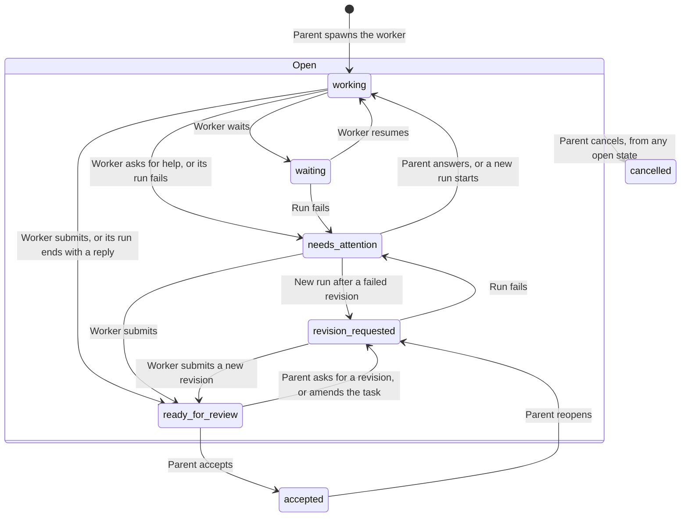

This page lists the actions you or an agent can use on sessions in a Hive, with the limits and states behind them. For how to use a Hive, see [Hives and sessions](/docs/using-openwaggle/hives-and-sessions).

The same actions exist in three places. An agent running in OpenWaggle calls them through its `hive` tool, for example `hive({ action: "follow_up" })`. A terminal or another agent uses the [Hive CLI](/docs/developer-workflow/hive-cli), where the name uses `-` instead of `_` (`openwaggle hive follow-up`). The `openwaggle_hive` MCP tool uses the CLI names. Scheduled tasks have their own [`openwaggle schedules`](/docs/using-openwaggle/scheduled-tasks-reference#commands) command.

Each action needs a session capability, shown in the tables below. The `hive` tool only offers an agent the actions its session's capabilities allow. A call to any other action fails and names what is missing, for example `capability_denied: the hive action fork requires sessions:create and sessions:read`. `launch` and `spawn` also fail when **Agent-created Workers** is off for the project or model.

## Start sessions

| Action | Capability | What it does |
| --- | --- | --- |
| `create` | `sessions:create` | Creates a new, idle top-level session. It does not start a run. |
| `launch` | `sessions:create`, `sessions:start` | Creates a new top-level session and starts its first run, in one step. |
| `spawn` | `sessions:spawn` | Creates a worker under the calling session and starts it on its task, in one step. It also records the delegation. Give it a title, or OpenWaggle names it from the task. |
| `fork` | `sessions:create`, `sessions:read` | Creates a new session from a point in an existing transcript. |

`spawn` takes the task as `objective`, and optionally `agent` (an [agent definition](/docs/extending/agent-definitions)), `model`, `thinking`, `workspace`, `deliverables`, `acceptanceCriteria` and `authorization`. A worker starts with only what the parent gives it. It cannot see the parent's transcript.

A spawn without `agent` whose task restates the role of one of the project's definitions returns a `suggestedAgent` hint that names that definition. The hint never changes the spawn.

### Workspace choices

| Value | Used by | Where the session runs |
| --- | --- | --- |
| `share-parent` | `spawn` | The parent's checkout. The default for a worker, unless its agent definition sets `workspace`. |
| `current` | `create`, `launch` | The checkout the caller works in. The default. |
| `share-source` | `fork` | The checkout of the session it forks. |
| `local` | all, and `handoff` | The project's main checkout, the folder you opened. |
| `new-worktree` | all, and `handoff` | A new Git worktree. `baseRef` names the branch or commit it starts from. |
| `existing` | `create`, `launch`, `fork`, `handoff` | A workspace OpenWaggle already knows, named by `workspaceId`. |

For an agent, `current` is its own workspace, which can be a worktree. For the CLI, it is the checkout that contains the folder you run the command from. A caller outside the project, or in a folder OpenWaggle does not manage, gets the project's main checkout. A caller inside a worktree that is not ready, such as one still being set up or one whose setup failed, gets an error that suggests `local`.

To start a session in another project, `create` and `launch` take its `projectPath`. Leaving `workspace` out there means `current`, which from outside that project is its main checkout.

## Send messages and control runs

A run is one turn of the agent working in a session, from your message to its final reply.

| Action | Capability | What it does |
| --- | --- | --- |
| `message` | `sessions:message` | Starts a run if the session is idle. Otherwise adds a follow-up to the queue. |
| `start` | `sessions:start` | Starts a run on an idle session. It never queues. |
| `follow_up` | `sessions:message` | Adds a follow-up: a separate run that starts after the current one. |
| `steer` | `sessions:steer` | Adds guidance to the run that is going now, without stopping it. Needs that run's ID. |
| `replace` | `sessions:message`, `sessions:interrupt` | Stops the current run and starts the new message as a new run. Needs the run's ID. |
| `promote` | `sessions:queue`, `sessions:steer` | Takes one queued follow-up out of the queue and delivers it as steering to the current run. |
| `interrupt` | `sessions:interrupt` | Stops the current run without starting another. Needs the run's ID. |
| `interrupt_descendants` | `sessions:interrupt` | Stops the runs of every worker below a session. |
| `report` | `sessions:report` | Passes a note to the parent (`upstream`), the Queen, or named sessions. It never starts or steers a run. |

`steer`, `replace`, `promote` and `interrupt` need the ID of the run they act on (`expectedRunId`, or `--expected-run` in the CLI). If that run has already ended, the call fails instead of reaching the wrong run. Steering does not cancel a tool that is already running.

`message` on an idle session whose queue is paused still starts the run, and the paused follow-ups stay queued. A `follow_up` sent to an idle session with a paused queue waits in the queue, unless you send it and the queue waits only on agents' run limits: then it starts at once. The result says so with `queueState` and, when known, `pauseReason`. A follow-up sent just as the current run ends starts as the next run, unless a run limit holds it back (see [run limits](#run-limits)).

When you stop or interrupt a run before the agent wrote anything, the transcript gets no empty reply. Whatever the agent had already written stays.

## Manage sessions

| Action | Capability | What it does |
| --- | --- | --- |
| `rename` | `sessions:organize` | Changes a session's title. |
| `archive` | `sessions:organize` | Archives a session. Nothing is deleted. |
| `unarchive` | `sessions:organize` | Brings an archived session back, or cancels an archive its agent asked for. |
| `handoff` | `sessions:organize` | Moves a session to another workspace the caller may use. |
| `request_respond` | `sessions:respond` | Answers a question a run is waiting on. |
| `approval_respond` | `sessions:approve` | Answers an approval request a run is waiting on. |
| `authorization_set` | `sessions:authorization` | Changes a session's access mode, within the caller's limit. |

For an agent that archives its own session, see [When an agent archives its own session](#when-an-agent-archives-its-own-session).

## Manage the follow-up queue

| Action | Capability | What it does |
| --- | --- | --- |
| `queue_list` | `sessions:queue` | Lists queued follow-ups, and why a paused queue paused. |
| `queue_withdraw` | `sessions:queue` | Removes follow-ups before they are sent. |
| `queue_reorder` | `sessions:queue` | Changes the order of queued follow-ups. |
| `queue_pause` | `sessions:queue` | Stops sending queued follow-ups. It does not stop the current run. |
| `queue_resume` | `sessions:queue` | Starts sending queued follow-ups again, one at a time. |

`queue_reorder`, `queue_pause` and `queue_resume` need the queue revision you last read (`queueRevision`). If someone changed the queue since, the call fails instead of overwriting their change. A change reports the follow-ups still queued as `remainingFollowUpIds`, and `queue_withdraw` also reports the ones it removed as `withdrawnFollowUpIds`.

## Find and read sessions

| Action | Capability | What it does |
| --- | --- | --- |
| `list` | `sessions:discover` | Lists sessions. |
| `search` | `sessions:discover` | Searches sessions by title, task and other summary fields. |
| `read` | `sessions:read` | Reads a session's summary and state. |
| `status` | `sessions:read` | Reads a session's current run and queue. |
| `turns` | `sessions:read` | Pages through a session's turns. |
| `items` | `sessions:read` | Pages through a session's transcript items. |
| `requests_list` | `sessions:read` | Lists questions and approvals a run is waiting on. |
| `wait` | `sessions:read` | Waits until one of the sessions reaches a condition, or until the timeout. |
| `watch` | per event | Streams the Session Host events the caller may see. CLI and MCP only. |
| `agent_definitions_list` | none | Lists the project's enabled agent definitions. |
| `agent_definitions_search` | none | Searches those definitions by name and description. |

`wait` checks one condition: `idle`, `queue-empty`, `state-revision-after`, `report-delivered` or `correlated-reply`. It is a single wait, not a subscription, and it does not take up a run. Use `watch` for a stream of events.

`list`, `search` and `delegations_list` look at the caller's current project by default: its main checkout and every worktree of it. These options change what they return:

| Option | Effect |
| --- | --- |
| `catalogScope: "project"` | With `projectPath`, looks at another project. |
| `catalogScope: "all"` | Looks at every session the caller can reach. |
| `archived: true` | `list` returns only archived sessions. |
| `includeArchived: true` | `search` includes archived sessions. Each result carries `archived`. |
| `parentSessionId` | `list` returns only that session's direct workers. |
| `fullTranscript: true` | `search` also searches transcript text. Needs `sessions:read`. |
| `states` | `delegations_list` returns only delegations in these states. |

Without options, `list` and `search` leave archived sessions out, and `delegations_list` returns delegations in every state, newest first. Every listed or read session reports its `depth` in its Hive, `0` for the top-level session.

`agent_definitions_list` and `agent_definitions_search` read the caller's own project. With `projectPath` they read another project, which needs `sessions:create` and `sessions:discover`. A worker cannot read another project (`capability_denied`). A top-level session that cannot reach that project gets `target_scope_denied`. They refuse a folder that does not exist, or that is neither open in OpenWaggle nor has a session there.

## Review delegations

Each spawn creates one delegation: the task, and the worker's results for it. The worker works on it and submits results. The parent reviews them.

| Action | Capability | Who uses it | What it does |
| --- | --- | --- | --- |
| `delegation_submit` | `delegations:contribute` | Worker | Submits a result, with evidence, as a new revision. |
| `delegation_state` | `delegations:contribute` | Worker | Sets `working`, `waiting` or `needs_attention`, with a reason. |
| `delegation_claim` | `delegations:contribute` | Worker | Records the files or areas it plans to change. Claims are advisory and lock nothing. |
| `delegation_propose_amendment` | `delegations:contribute` | Worker | Proposes a change to the task. |
| `delegation_amend` | `delegations:review` | Parent | Changes the task, or accepts a proposed change. |
| `delegation_request_revision` | `delegations:review` | Parent | Asks for a new revision of a submitted result, with feedback, and sends it to the worker. |
| `delegation_accept` | `delegations:review` | Parent | Accepts one submitted revision. |
| `delegation_verify` | `delegations:review` | Parent | Records a check of a submitted revision: `passed`, `failed` or `inconclusive`. |
| `delegation_reopen` | `delegations:review` | Parent | Reopens an accepted delegation and sends the reason to the worker. |
| `delegation_cancel` | `delegations:review` | Parent | Cancels an open delegation. |
| `delegation_dependency` | `delegations:review` | Parent | Makes a delegation wait for another to reach a state. |
| `delegation_conflict_acknowledge` | `delegations:review` | Parent | Marks a reported conflict between claims as seen. |
| `delegations_list` | `delegations:read` | Either | Lists delegations. |
| `delegations_read` | `delegations:read` | Either | Pages through one delegation's history. |
| `delegations_conflicts` | `delegations:read` | Either | Lists overlaps between claims (`live-overlap`, `merge-overlap`). |

A submitted revision never changes. `delegation_request_revision` and `delegation_accept` name the revision they answer (`submissionRevision`).

## Delegation states

| State | Open | Meaning |
| --- | --- | --- |
| `working` | Yes | The worker is on the task. |
| `waiting` | Yes | The worker is waiting, for example on another worker. |
| `needs_attention` | Yes | The worker asked its parent for help, or its last run failed. |
| `ready_for_review` | Yes | The worker submitted a result. |
| `revision_requested` | Yes | The parent asked for a new revision. |
| `accepted` | No | The parent accepted a revision. It can only be reopened. |
| `cancelled` | No | The parent cancelled the delegation. |

In an open state the worker can set `working`, `waiting` or `needs_attention` itself, and the parent can cancel. A worker run that is interrupted, or that ends without a reply, counts as failed in the diagram.

A worker whose run ends normally with a reply, without submitting, gets that reply captured as a submission, so its result is not lost. A worker that set `needs_attention` itself keeps that state when its run ends, even if it replied. The reply explains what it needs and is not a result. Once the parent answers, OpenWaggle captures the next run that ends with a reply as usual.

A `needs_attention` that OpenWaggle set for a failed run goes back to `working` (or `revision_requested`) when a new run starts on the worker. One the worker set itself goes back to `working` when its parent's agent sends it anything. The history keeps both changes, by `session-host` and by the parent.

### When the parent asks for a revision

These actions send the worker back to work and set the delegation to `revision_requested`:

- `delegation_request_revision`
- `delegation_reopen`
- `delegation_amend` or `delegation_dependency` while the worker's result is `ready_for_review`

OpenWaggle then queues a follow-up on the worker from whoever made the change. The follow-up starts with `OpenWaggle Host-authored Delegation revision request` and carries these values:

| Value | What it is |
| --- | --- |
| `delegationId` | The delegation. |
| `parentSessionId` | The parent session. |
| `submissionRevision` | The submission the parent reviewed, reopened or set aside. |
| `specificationRevision` | Only when the task changed. The new task arrives as its own specification update. |
| `feedback` | The feedback, or the reason for a reopen or a task change. |

- An idle worker starts a run on it straight away.
- A busy worker gets it after its current run. The reply of that current run does not count as the new revision. The reply of the run that reads the feedback does.
- `delegation_amend` or `delegation_dependency` on a worker that is still on the task, such as one that is `working` or already revising, queues nothing. The new task reaches its current run, or its next one.
- It is a follow-up from the reviewer, so the queue rules and run limits are the ones for that reviewer's other follow-ups.
- The reviewer must be allowed to message the worker. A reviewer that may not, such as a CLI client profile without `sessions:message` on it, gets `worker_message_denied` (kind `authorization`, CLI exit 4) for any of these actions that would send the worker back to work, and the delegation does not change. Ask someone who may message the worker, such as the person, to send the revision.

### When a worker reports to an idle parent

The parent hears about every result and every request for help as an update from OpenWaggle. A running parent reads the update at its next model request in the current run. An update that arrives while the parent writes its last answer, or after it, waits for the parent's next model request. That is usually the Waggle the run hands off to, if any, or else a new run. When the parent is idle, OpenWaggle starts a new run on it with the update, so a Queen that said it would report back when its workers finish does report back.

| Update | Sent when |
| --- | --- |
| `ready_for_review` | The worker submits, or its run ends with a reply. |
| `needs_attention` | The worker's run fails, is interrupted, or ends without a reply, or the worker sets `needs_attention` itself. |

OpenWaggle starts that run only when all of these hold:

- The parent has no active run and no queued follow-up, apart from agents' follow-ups that a run limit holds back (`pauseReason` `parent-limit`).
- The parent is not archived.
- The parent's last run completed or failed. A run you stopped leaves the parent alone until you send it something.
- The parent was not last continued in the pi CLI.
- The Session Host is not shutting down, as it does to install an app update. Worker updates that arrive meanwhile, such as from worker runs it stopped, wait for the parent's next run. **Restart now** stops runs as you before the Session Host starts shutting down, so a parent whose workers it stopped can still start a run. Installing the app update then stops that run within about 13 seconds.
- Whoever started the parent's last run may still send it a message. A revoked CLI client profile, or one without `sessions:message`, gets no run.
- A CLI client profile or MCP client behind the update is also behind the parent's last run. That covers a result or request for help a profile sets for a worker, and everything in a worker run that a profile started, including a run OpenWaggle started for worker updates on a profile's behalf. Otherwise the update starts no run, even if it arrived while the parent wrote its last answer, and the parent reads it at its next run. A Hive that a profile started still wakes its parent. A worker run counts as whoever started it, even when a client steered it or answered its questions. A run that a client stopped counts as that client's, unless the run still completed. A run the Session Host stopped to shut down still counts as whoever started it.

The run acts for whoever started the parent's last run, in the parent's own access mode. It runs in **Ask for approval** instead when that last run was started with **Ask for approval** for that run only, or when that caller's ceiling is **Ask for approval** now. When an `openwaggle mcp serve --owner` server started that last run, the run always uses **Ask for approval**, because OpenWaggle cannot check that server's grants after it exits. It is always a standard run, even when the last run was a Waggle. When the parent is itself a worker, or a top-level session an agent made, the run counts toward **Active Workers** (and a worker's toward **Workers per parent**), and when a limit is full, OpenWaggle tries again when another run ends. A top-level parent you started, such as your Queen, is never held back by the limits.

OpenWaggle checks these rules again just before the run starts, so a parent that got a run, a follow-up or was archived in the meantime is left alone, and so is one whose last caller lost the right to message it. When the parent is itself a worker that asked its own parent for help, the run does not count as that parent's answer, and its reply does not count as the worker's result. The request stays open. When the parent is itself a worker whose result waits for review, a result the run submits replaces that result, and its own parent hears about it. The run's reply replaces it only when that result was a reply too, not one the worker submitted. A run that fails, is stopped or ends without a reply leaves that result for its parent to review.

Each update starts at most one run. If that run fails, OpenWaggle waits for the next update, or for you to send the parent a message, which also delivers the update. In the parent's transcript, the run starts with a **Hive · Worker updates arrived** line instead of a message from you. Several updates that arrive close together go into the same run.

### Who acts next

Every session summary and delegation that carries a delegation state (`list`, `search`, `read`, `delegations_list` and `delegations_read`) also carries `nextActor`, who acts next on that worker.

| `nextActor` | Who | When |
| --- | --- | --- |
| `user` | You | A run waits on an approval or a question, or the worker is stuck. |
| `parent` | The parent agent | It has a `ready_for_review` result to review, a failed run to see, a request for help to answer, or a worker that set `waiting` to follow up. |
| `worker` | The worker | It is `working`, or revising after `revision_requested`. |
| `none` | Nobody | The delegation is `accepted` or `cancelled`. |

A worker is stuck when its last run failed or was interrupted, or it asked its parent for help, and its parent has no active run and nothing queued to deliver.

OpenWaggle works out `nextActor` each time you read, by the same rule the Hive panel uses, so it follows the parent's runs and queue as they change. It never changes the delegation state. The result of an action that changes something, such as `spawn` or `delegation_accept`, has no `nextActor`. OpenWaggle saves that result to answer a repeated request, and a saved `nextActor` would go stale. Read the session or the delegation instead.

## Export transcripts

| Action | Capability | What it does |
| --- | --- | --- |
| `export` | `sessions:export`, `sessions:read` | Streams a transcript as Markdown or JSONL. |
| `export_create` | `sessions:export`, `sessions:read` | Writes a Markdown, JSONL or bundle file. Asks you before it writes. |
| `export_cancel` | `sessions:export` | Cancels a file export. |
| `exports_list` | `sessions:export`, `sessions:read` | Lists file exports. |
| `exports_read` | `sessions:export`, `sessions:read` | Reads one file export. |
| `exports_wait` | `sessions:export`, `sessions:read` | Waits for a file export to finish. |
| `exports_watch` | per event | Streams export events. CLI and MCP only. |

## Scheduled tasks

The `hive` tool's `schedule_list`, `schedule_read` and `schedule_runs` need `schedules:read`. `schedule_create`, `schedule_update`, `schedule_delete`, `schedule_run_now` and `schedule_outcome` need `schedules:manage`. The [scheduled tasks reference](/docs/using-openwaggle/scheduled-tasks-reference) lists their commands, options and limits.

## Follow-up queue rules

| Rule | Value |
| --- | --- |
| Most queued follow-ups | 256 |
| Most queued data | 32 MiB |
| Error when full | `queue_capacity_reached` or `queue_byte_capacity_reached` |
| Delivery | One follow-up at a time |

OpenWaggle keeps the follow-up queue when the app restarts, the window disconnects, or the Session Host recovers. It is separate from Pi's own internal steering queue.

A failed, interrupted or timed-out run pauses the queue, but only for follow-ups queued before the run ended. A follow-up queued after that starts when the run settles. A run limit can also pause it when a run ends, as [run limits](#run-limits) describes. Pausing never stops a run.

If the access that queued a follow-up is revoked or no longer covers the session, the follow-up waits in the queue, marked as needing attention. In the app, **Send as me** sends it with your own access instead. The queue keeps who first queued it, and you can no longer edit the message. You can also dismiss it.

## Steering that comes back

A steered message the agent has not read yet is not lost when its run ends first. If you stop, interrupt or replace the run, or it ends without reading the message, the message goes back to the front of the follow-up queue, in the order it was steered.

| Case | What happens |
| --- | --- |
| Promoted follow-up | Comes back with its ID, text, attachments and options. |
| Direct steer | Comes back as a new follow-up from the same caller, with its text, attachments and visualization context. |
| Already being read | Stays in the transcript. It does not come back. |
| Waiting for compaction | The Session Host refuses the steer, so the caller still has it. |
| After a Session Host crash | Nothing comes back. OpenWaggle cannot tell which messages were read. |

A direct steer that comes back runs with the session's settings, like any steer. `queue_list` marks it as `returnedSteer`, with the steer's run and its idempotency key, so the caller can find it instead of sending it again.

Returned steers can push the queue past 256. To keep it from growing without limit, the Session Host refuses a direct steer with `queue_capacity_reached` while the queue is full, and with `steering_capacity_reached` once the run holds 64 steers it could return. A stopped run pauses the queue as usual, so you can resume, steer or dismiss what came back.

When you promote a follow-up in the app, its preview moves into the conversation while the Session Host handles it, and shows that it is waiting during compaction. The preview stays until the message reaches the transcript, even if you switch sessions. If the promotion is refused, the follow-up stays in the queue.

## Thinking level and access per run

A session's model and thinking level are session settings. A run uses them when it starts. They can change only while no run is starting, running or stopping. A session that is only waiting on its queue can change them.

| Action | `thinking` | `authorization` |
| --- | --- | --- |
| `create` | Sets the starting level | Not accepted, no run starts |
| `launch`, `spawn` | Sets the starting level | Applies to the first run |
| `message`, `start` on an idle session | Becomes the session's level | Applies to that run |
| `message` while a run is active | Refused | Refused |
| `follow_up`, `steer`, `replace` | Never accepted | Never accepted |

A refused `message` fails with `thinking_level_requires_idle_session` or `run_authorization_override_requires_idle_session`. So a queued follow-up always runs with the session's settings when its turn comes. An `authorization` override never changes the session's saved mode, and stays within the caller's limit. `yolo` needs a caller that already has full access. An `ask-for-approval` override, from `launch`, `spawn`, `message` or `start`, also applies to the runs OpenWaggle starts for worker updates after the run it applied to, as [When a worker reports to an idle parent](#when-a-worker-reports-to-an-idle-parent) describes.

A worker gets its parent's access by default. A spawn or an [agent definition](/docs/extending/agent-definitions) can keep or narrow approvals, tools, MCP servers and session capabilities. It cannot widen them.

## Run limits

Two settings in **Settings > Agents > Hive controls** cap how many worker runs go at once. **Workers per parent** defaults to 4 runs at a time by one parent's direct workers, and **Active Workers** to 16 worker runs across the whole app. [Settings](/docs/reference/settings) lists both. A `spawn`, or a `message`, `follow_up` or `start` that would start a worker's run, fails at either limit with an error the caller can retry (`host_capacity_reached` or `parent_capacity_reached` for a `spawn`, and `host_run_ceiling_reached` or `parent_concurrency_limit_reached` for a run). It is not queued. An agent's `queue_resume` that would start such a run fails the same way, and an agent's withdraw or reorder that would start one pauses the queue instead. When a run ends and the next follow-up in its queue is an agent's that would pass a limit, the queue pauses too, with `pauseReason` `parent-limit` at either limit. Nothing resumes it by itself. Call `queue_resume` once a slot frees. A follow-up you queued never waits behind those. When the session is idle, your first follow-up in that queue starts ahead of the agents' ones, and the queue stays paused for theirs. A parent whose workers report is woken past them too. Your **Resume** starts the next follow-up whatever the limits. A run OpenWaggle starts for a parent whose workers reported is the exception, because it is retried when another run ends.

The limits never hold back your own runs:

- Your runs in sessions you made never count toward the limits. Your runs in a worker do count, but are never refused. In a top-level session you started, such as your Queen, OpenWaggle's run for a parent whose workers reported is never refused either.
- A run you start yourself, from the app, the command line or another client running as you, is never refused, even in a worker. So is a run that your own **Resume**, withdraw, reorder or edit of a queue starts, whoever wrote the follow-up. A follow-up you queued in a worker runs next even when its parent is at **Workers per parent**.
- A `launch` of yours has no run limit. A `spawn` always makes a worker, so it is held to the limits whoever asks for it.

Sessions agents make count as workers for **Active Workers**: a top-level session that an agent or an access profile launched, created or forked, or that a scheduled task launched for an agent's work. An agent's `launch` fails with `host_run_ceiling_reached` when **Active Workers** is full, so launching instead of spawning does not get around the limit.

A run an agent starts in a top-level session you made counts toward **Active Workers** too. That covers an agent's `message`, `follow_up` or `start`, the next follow-up in your queue when an agent wrote it, and a scheduled task's agent work firing there. At a full limit such a run fails with `host_run_ceiling_reached`, or pauses the queue, as for a worker. So an agent cannot get around the limit by sending work to your sessions.

The limits count active runs of agents' work, not saved sessions, queues, searches, exports, waits or watchers.

## Worker cleanup timing

When a parent accepts or cancels a worker you never touched, OpenWaggle archives the worker once it is idle. A worker it keeps because you have it open, or because it has a terminal, a browser preview or a running project service, gets another check after 15 seconds, then 30 seconds, 1 minute, 2 minutes, and every 5 minutes after that.

## When an agent archives its own session

An agent can archive its own session through its `hive` tool. OpenWaggle does not stop the run that asked.

The call returns `effect: "session-archive-deferred"` with that run's `runId`. The agent can still write its final message.

To have a Launch schedule's agent archive its session, see [Scheduled tasks](/docs/using-openwaggle/scheduled-tasks#run-a-launch-schedule).

Once that run ends, OpenWaggle archives the session unless one of these is true:

- The run did not complete. It failed, or someone stopped it.
- Another run started, or a follow-up is waiting in the queue.
- A worker sent the session an update that no run has read yet.
- One of the session's workers is still working on its delegation.
- Someone called `unarchive` on the session after the agent asked.
- The session is pinned.
- Something else archived it first.

A message you steer into the run that asked does not cancel the archive. OpenWaggle does not retry a skipped archive or tell the agent. A worker that archives itself counts as archived on purpose, so new work does not bring it back. If its archive is skipped, worker cleanup can still archive it once its result is accepted or cancelled.

If the Session Host stops or restarts before the run ends, for example to install an update, the session stays unarchived.

If the agent runs `openwaggle hive archive` in a shell, or calls the `openwaggle_hive` MCP tool, OpenWaggle archives the session right away. That stops the run that asked, so the agent does not get to write its last message.

## Errors

| Code | Meaning |
| --- | --- |
| `capability_denied` | The session lacks a capability the action needs. |
| `target_scope_denied` | The session exists, but is outside the caller's reach. |
| `target_not_authorized` | A `report` target outside the caller's reach. |
| `session_not_found` | No session has that ID. |
| `delegation_not_found` | No delegation has that ID. |
| `queue_capacity_reached` | The follow-up queue holds 256 entries. |
| `queue_byte_capacity_reached` | The follow-up queue holds 32 MiB. |
| `steering_capacity_reached` | The run already holds 64 steers it could return. |

The [Hive CLI reference](/docs/developer-workflow/hive-cli#error-kinds-and-exit-codes) lists the exit code for each kind of error.
