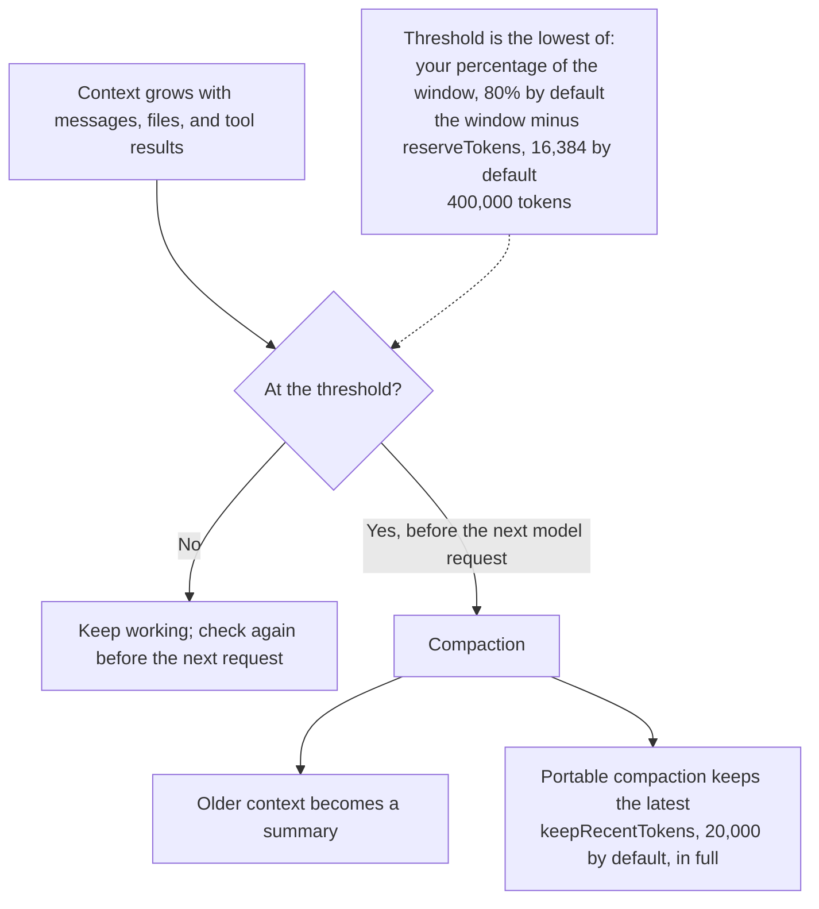

A model's context window is how much it can take in with one request. Your messages, the agent's replies, file contents, tool results and instructions all use space in it. Models measure that space in tokens, which are pieces of words.

You usually don't have to manage this. When a conversation gets long, OpenWaggle compacts its context so work can go on. It replaces older context with a shorter summary and keeps recent work as it was. Compaction doesn't delete anything from the saved conversation, and you can still scroll through all of it. Messages from before a compaction stay above its **Context compacted** marker, while the model works from the compacted context.

## Check the context meter

The context meter sits at the right of the message box, beside the model and thinking level pickers, when there is room for it. Its ring shows the percentage of the selected model's context window in use, and the number after it is the window's size in tokens. Hover the meter for details:


- **Context** shows the tokens in use out of the window's size, and the percentage.
- **Session** shows the session's total tokens and cost, then the cost and tokens of each model that answered.

Costs include model calls from [codemode](/docs/using-openwaggle/codemode) scripts and prompt cache refreshes. Usage that belongs to no single model, such as model calls from scripts and summaries, is listed as **Tools and summaries**. Costs are what Pi's model catalog says the provider charges. Your provider's bill has the final say. To see spending across all your sessions, open [Usage and cost](/docs/using-openwaggle/usage-and-cost).

With a [virtual model](/docs/providers/virtual-models) selected, the meter uses the context window of the real model that wrote the latest reply, because each real model has its own limit. While a turn is running, the meter stays on the model the turn started with, even if you pick another model.

The meter shows the usage Pi reported for the latest response, not a live count as you type. It shows `?` while usage is unknown, for example after a compaction until the next response. If OpenWaggle can't load the usage, the details say **Context usage unavailable**. The meter only shows usage and has no controls. It doesn't show the compaction threshold or which kind of compaction ran.

## Compact a conversation yourself

To compact before you go on with a long task, wait until the agent is idle, then type this in the message box, or pick **Compact session** from the `/` menu, and send it:

```text
/compact
```

To make sure some details survive, add instructions after the command:

```text
/compact preserve the schema decisions, migration constraints, and tests still to run
```

This runs a command. The agent doesn't reply to it as a message. The conversation shows the compaction's progress. When it is done, a **Context compacted** marker stays where the compaction happened, and you can carry on with your next task.


A summary can leave things out. Keep lasting project conventions in [project instructions](/docs/extending/agents-md), and repeat an important constraint if the agent seems to have lost it.

## Change when compaction happens

By default, OpenWaggle compacts when the context reaches **80%** of the model's context window. To change the percentage, open **Settings > General > Context compaction**. The setting applies to every project and session.

Whatever the percentage, automatic compaction happens by **400,000 tokens** at the latest. Every request sends the whole context again, so on a model with a 1M-token window, a context of 800,000 tokens makes each later request about twice as expensive and slow as one at 400,000 tokens.

Compaction happens before a request to the model, never while a reply is streaming. If the agent is idle when the context crosses the threshold, OpenWaggle waits for your next message. During a task, it can compact between a tool result and the next request.

The model also needs room for its reply, so OpenWaggle may compact before your percentage when that room would run out. The threshold is the lowest of three limits. Pi's `compaction.reserveTokens` sets the room kept for the reply, and `compaction.keepRecentTokens` sets how much recent context stays in full:



## Compaction while you are away

Providers keep a conversation's prompt cache for about five minutes. After that, your next message pays to send the whole context again. When you leave a session idle with at least 200,000 tokens of context, OpenWaggle prepares the compacted context shortly before the cache expires, while reading it is still cheap.

If you come back after the cache expired, the session continues from the compacted context, and the conversation shows a **Context automatically compacted** marker. If you come back sooner, OpenWaggle drops the prepared summary and nothing changes. The summary request counts toward the session's usage.

This doesn't happen when **Keep prompt caches warm** is **Off** or **Between runs**, and a prepared summary doesn't survive an OpenWaggle restart.

## How compaction works

OpenWaggle picks one of two kinds of compaction for you:

- **Native** compaction uses the provider's own compaction when the model connection supports it. Only a compatible connection can reuse its result.
- **Portable** compaction asks the model for a summary in four parts and keeps the recent conversation in full. A tool call and its result always stay together.

You can still work with messages above a marker. Going back to one, or editing and resending it, continues from that point with that branch's own context, which doesn't include the later compaction. OpenWaggle compacts it again if it doesn't fit. Forking or cloning copies the conversation up to that message into a new session. Search, exports and session reads include the whole conversation.

If you switch to a model that can't use a Native result, OpenWaggle rebuilds the context from the saved history with the new model. It doesn't call the previous provider. If the new model has a smaller window, the request leaves out the oldest complete exchanges, after keeping room for instructions, tools and the reply. Those exchanges stay in the saved history.

For Pi's side of this, see [Compaction & Branch Summarization](https://github.com/badlogic/pi-mono/blob/main/packages/coding-agent/docs/compaction.md).

## Branch summaries

A branch summary is something else. When you go back to an earlier point in the [Session Tree](/docs/using-openwaggle/session-tree), it can carry what matters from the work you are leaving into the new branch. When OpenWaggle asks, choose:

- **No summary** to continue from the earlier point without the later work.
- **Summarize** to bring a summary of the later work.
- **Custom** to write instructions for the summary in the message box, then send them. They shape the summary, and the agent doesn't treat them as a task.
- **Cancel** to go back to where you were.

Pi's `branchSummary.skipPrompt` setting skips this question.

## Model limits

How much fits depends on the model. A model with a bigger window helps with a large task, but it doesn't put your whole project into the conversation. The agent still has to read the files it needs, or get them from you as references and attachments.
