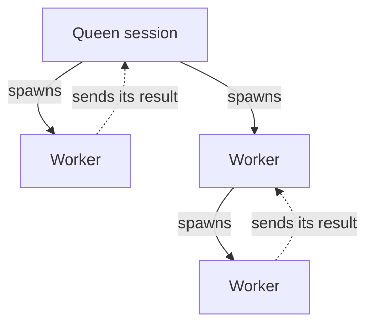

A Hive lets one agent hand parts of a task to other agents and collect their results. Each of those agents works in its own session, called a worker, so one can trace a bug while another reviews the tests. Use a Hive when a task splits into parts that do not depend on each other. For most tasks a normal conversation is enough.

The session you start the Hive from is the **Queen**. The sessions it creates are its workers, and a worker can create workers of its own. Each worker reports to the session that created it, so a Hive is a tree:



A worker is a full session. It has its own transcript, model and queue of messages, and it is saved like any other session. It keeps running when you switch to another session, and it can keep going after the Queen's own turn ends. Being the Queen gives a session no extra permissions over other sessions.

If you want two agents to take turns in the same conversation instead, use [Waggle](/docs/using-openwaggle/waggle-mode).

## Start a Hive

Ask the agent in a normal session to split a concrete job. Say what each worker should do, what it must not do, and which files it needs:

```text
Create two workers to investigate this repository's login flow.
Have one trace the implementation and one review the tests for missing cases.
Do not edit files or commit anything. Give each worker the relevant paths.
Review their findings here and identify which claims are supported by code or tests.
```

Your session becomes the Queen. The agent creates the workers and gives each one its task. A worker starts with only what the agent tells it and cannot see the Queen's conversation, so a good request names the files and the goal.

The workers send their results back to the Queen's agent. It reviews them and gives you one answer in your original session. You can keep talking to the Queen while the workers run.

Each worker makes its own calls to your model provider, and each call is billed or counts against your plan. Telling a worker "do not edit" is an instruction, not a lock. Check the session's [approval settings](/docs/configuration/approvals-permissions) before you hand out work that matters.

## Watch workers in the Hive panel

The **Hive** panel lists every session in the Hive, from the Queen down. Open it from the chess queen icon on the panel rail, or select the **Hive** row in the [Session Summary](/docs/using-openwaggle/session-summary). It works from any session in a Hive, and the header counts the workers in it.


The panel is a table with three columns. **Session** is the title, **Workspace** is the checkout or worktree the session runs in, and **State** says where its work stands. Each worker sits under the session that created it, and a parent shows how many workers it has.

- Click a row to open that session. The panel stays open, so you can move around the Hive. While a worker is open, its Queen's row in the sidebar keeps a second highlight.
- Collapse a parent with its arrow. A collapsed parent still shows how many of its workers need you and, in a muted color, how many wait for an agent. The panel remembers what you collapsed.
- Archived workers are hidden and counted on their parent. Turn on **Show archived** to see them.
- With the keyboard, the arrow keys move through the tree and open or close a parent, and Enter opens a session.

The sidebar lists only top-level sessions, not workers. To keep a worker there, choose **Pin session** from its row's ⋯ menu or right-click menu, which are the same menus as in the sidebar. A pinned worker shows its project and **Spawned by** its parent. **Unpin session** sends it back to the panel. The sidebar's status filters and search still find workers, listed flat with their parent named.

### Who acts next

Each row's **State** says who acts next and why. Turn on **By next actor** to group the whole Hive that way. Each deeper row then names its parent as **Spawned by**, with a link to it.


| Group | Who acts next | What a row says |
| --- | --- | --- |
| **Needs you** | You | **Waiting for your approval**, **Waiting for your answer**, or **Stuck** |
| **Waiting for ‹parent›** | The agent that created the worker | **Ready for review**, **Run failed, ‹parent› notified**, **Asked ‹parent› for help**, or **Finished its turn** |
| **Working** | The worker | **Working**, **Revising**, or **Connecting** |
| **Closed** | Nobody | **Accepted** or **Cancelled** |
| **Archived · n** | Nobody | Collapsed until you open it |

**Waiting for ‹parent›** names the parent, for example **Waiting for Queen**, with one group for each parent.

**Needs you** holds only what you must unblock: a worker, or the Queen herself, waiting for your approval or your answer, and a worker that is stuck. A worker is stuck when its last run failed or was interrupted, or it asked its parent for help, and its parent is not running and has nothing queued. No agent will pick it up, so the row says so. While the parent is running, the same worker waits for the parent instead.

The **Hive** row in the Session Summary counts the open session's direct workers by the same groups.

The labels clear when the situation ends. **Run failed, ‹parent› notified** clears as soon as a new run starts on the worker, whoever starts it. **Asked ‹parent› for help** clears when the parent sends the worker anything, or when the worker says it is working again. The failure stays in the worker's transcript and its delegation history, and the parent agent still hears about every change.

Only **Needs you** reaches you outside the panel. It shows as a dot on the panel rail icon, a line under the Queen in the sidebar such as "1 needs you", and a count in the Session Summary. The Queen's sidebar line also shows a muted "2 waiting for ‹Queen›" for workers waiting on her, with no dot.

## Give workers a role

An [agent definition](/docs/extending/agent-definitions) is a saved role, such as a code reviewer, with its own instructions and defaults. A session that can create workers sees the names and descriptions of the project's enabled definitions, and its agent picks one when it fits a worker's job. You can also ask for one by name: "Use the code-reviewer definition for this worker". A worker without a definition is an ordinary agent.

In the Hive panel, a worker created from a definition shows an agent icon instead of the pickaxe. A line under its title names the definition, the thinking level set for the worker, and the model it runs with, for example `reviewer · High · GLM-5.3-Flash`. It says `No thinking` when thinking is off. Hover the line for the full model name; a screen reader reads all three with the row. The panel's toolbar counts the sessions per definition, such as `reviewer ×6`, so you can see whether the Queen uses them.

## Talk to a worker

Click a worker in the Hive panel to open it, then type in its composer as in any session. Answer its questions and approval requests there; they are the rows under **Needs you**.

If the worker is busy, your message waits above the message box as a follow-up, and starts as the next run when the current one finishes. To put it into the run that is going now instead, choose **Steer** on the queued message. Steering does not stop the run. Use it only for guidance that belongs in that run. [Chat and tools](/docs/using-openwaggle/chat-and-tools#send-a-message-while-the-agent-works) covers the queue.

Switching between sessions never stops a run. A worker's Session Summary works as soon as it is created, even before it sends its first message.

To pass a finding along without starting new work, ask a worker to report it to its parent. A report reaches the other session as a note and never starts or steers a run.

If a worker's result needs fixing, you can also tell the Queen what to change, and its agent asks the worker for a new revision. The [Hive reference](/docs/reference/hive#send-messages-and-control-runs) lists every message action and the queue rules.

## Review and accept results

When a worker finishes, it submits its result to the agent that created it. That parent agent reviews the result and either asks for a revision or accepts it. OpenWaggle shows where each review stands, but you do not have to approve every result yourself.

A worker that ends its run with a reply but forgets to submit still has that reply kept as its result. A worker that asked for help keeps waiting for an answer, even if its last reply was text.

The Queen's summary is where your review starts, not where it ends. Before you rely on it, read the worker transcripts, the changed files and the test results. The [Hive reference](/docs/reference/hive#delegation-states) lists every delegation state and how a result moves between them.

## Choose a workspace for workers

By default a worker works in the same checkout as its parent. It reads and changes the same files you and other sessions are using. That is fine for reading and reviewing, and risky for edits.

For edits that should not collide, ask for each worker to get a **new worktree**, and give each one a clear scope. A separate worktree keeps the checkouts apart. It gives the worker no new file or Git permissions. You can also name a specific local checkout. If a worktree is missing, OpenWaggle never swaps in another checkout.

A new worktree can run your project's setup commands before the agent starts. The setup must succeed, or you must choose to continue, before the worker runs. If setup failed or its result is unclear, check **Workspace preparation** in the Session Summary instead of sending the task again. [Project actions](/docs/configuration/project-actions) explains how to configure setup.

When workers share a checkout, it is harder to tell who changed what. Workers can record which files they plan to change, and OpenWaggle reports overlaps, but nothing locks a file. Review overlapping edits yourself.

## Limit how many workers run

**Settings > Agents > Hive controls** has three settings:

- **Agent-created Workers** lets agents create workers in this app.
- **Workers per parent** is how many workers can run at once under one parent. The default is 4.
- **Active agent runs** is how many runs can go at once across the whole app, in every Hive and every other session. The default is 16.

Neither limit has a fixed maximum, but high values can strain your machine or your provider. A run that would go past a limit fails with an error the agent can retry later. It does not wait in a queue. Saved sessions do not count toward either limit. Project configuration files can override both settings, as [App settings](/docs/configuration/app-settings) describes.

## Stop workers and clean up

To stop a worker, open it and stop its run, or ask the Queen to stop it. If you stop a run before the agent wrote anything, the transcript gets no empty reply. Whatever it had written stays.

You do not need to archive finished workers yourself. When the parent agent accepts or cancels a worker's result, OpenWaggle archives that worker for the parent, as long as you never interacted with it. A worker that is still busy is archived once it is idle: no run going, nothing queued, and no question or approval waiting. Nothing is deleted.

Interacting with a worker keeps it out of this cleanup. That means sending it a message, follow-up or steering, replacing its run, answering one of its questions or approvals, reviewing its result yourself, branching its conversation, or renaming, archiving or restoring it, from the app or the CLI. Reading its transcript does not count. A pinned worker is never archived while it is pinned.

OpenWaggle also leaves a worker alone while it is open in the app, or while it has a terminal, a browser preview or a running project service that archiving would stop. A worker you leave while it runs stops counting as open once its run ends. OpenWaggle checks again on its own whether it can archive a worker it kept, first after 15 seconds and then less often, up to every 5 minutes. So closing the worker is enough. You do not need to start another run. The [Hive reference](/docs/reference/hive#worker-cleanup-timing) has the exact times. Cleanup works the same whether the worker shares a checkout or has its own worktree.

Archived workers stay listed under **Archived · n** in the Hive panel and in **Settings > Archived items**. To bring one back, choose **Unarchive session** from its menu in the Hive panel, or **Restore** in Settings.

Sending new work to a worker that cleanup archived brings it back in the same step. That covers a message, follow-up, steering, a replaced run, and reopening or asking for a revision of its result, whether you do it or an agent does. OpenWaggle does not archive a worker you brought back again. One that an agent brought back stays visible until its result is accepted or cancelled again, and then cleanup can archive it once more. A worker that you or an agent archived on purpose stays archived when it gets new work, and the parent agent can bring it back with `unarchive`.

## Keep a worker contained

Session capabilities limit what an agent can do through its `hive` tool and the Session Host. They are not an operating system sandbox. A worker that can still run any shell command, as your user, can act with your full authority outside that tool, including by calling the `openwaggle` CLI directly.

For real containment, remove shell and process tools in the worker's [agent definition](/docs/extending/agent-definitions), or run the agent in a separate sandbox, user account or container. [Named CLI profiles](/docs/developer-workflow/hive-cli#restricted-external-agent-profiles) help with attribution and least privilege only when the caller cannot also read your credentials.

Each worker gets its parent's access by default. A spawn or an agent definition can narrow approvals, tools, MCP servers and session capabilities, but never widen them. A worker gets **YOLO** access only when its parent is already allowed it.

## Work with sessions in other projects

An agent is not limited to its own repository. A session you started from the app can find and read sessions in any project that has a session in OpenWaggle, report to them, send them follow-ups, steer, stop or archive them, and start a new session there, without sharing a Hive. A project you only opened, without sending a message, does not count yet; start a session there first.

```text
Find the open OpenWaggle session about the release checklist and report this failing
check to it. If there isn't one, launch a session in ~/Projects/OpenWaggle on a new
worktree with this report as its objective.
```

To start work in another repository, the agent passes its path and chooses a local checkout or a new worktree. Without a choice, it uses that project's main checkout. The same capabilities and access limits apply there as in the agent's own project.

Workers stay inside their own Hive. A turn started by a worker's follow-up, or by a restricted CLI profile, stays in the session's own project, and a restricted profile cannot steer a turn that reaches other projects. A session started from a named CLI profile stays in its own project unless the profile covers every project. When OpenWaggle refuses a request, the tool says why, such as a missing capability.

## Where agents keep temporary files

Each session has a private scratch folder. OpenWaggle points `TMPDIR`, `TMP` and `TEMP` at it for the agent's shell tools and names it in the agent's instructions, so two agents writing `push.log` at the same time never overwrite or read each other's file. On macOS and Linux only your user account can open it.

OpenWaggle deletes the scratch folder when you archive or delete the session, or when the running turn ends if you archive it mid-turn. Keep anything you need in the workspace instead.

Screenshots and other files an agent wants to show you or another session go to a separate evidence folder, `$OPENWAGGLE_EVIDENCE_DIR`. It survives archiving, so a Queen can still show a finished worker's screenshots. OpenWaggle removes a session's evidence once nothing has been added to it for a week. [Data and file locations](/docs/reference/data-locations#temporary-files) gives the path of both folders on each platform.

## Control a Hive from outside the app

The Session Host is the background process that runs sessions and saves them. The desktop app, the CLI, the MCP server and the agents' `hive` tool all talk to it. So a worker created from the CLI appears in the Hive panel, and changes to queues, runs, requests and results show up in every open window. If a window falls too far behind, or the Session Host restarts, the window reloads the current state before it carries on.

An agent running in OpenWaggle uses its `hive` tool. Other coding agents use the [Hive CLI](/docs/developer-workflow/hive-cli) or the `openwaggle_hive` MCP tool.

Sessions created by the older MCP task feature keep their parent and worker links after the one-time Session Host upgrade. Those links are for finding your way around. They give no permission to control the sessions, and new workers use the current way of handing out tasks.

## Related pages

- [Hive actions and states](/docs/reference/hive) lists every action, the queue rules, delegation states and limits.
- [Hive CLI](/docs/developer-workflow/hive-cli) covers finding, messaging, waiting on, watching and exporting sessions from a terminal.
- [Agent definitions](/docs/extending/agent-definitions) explains reusable roles and how they restrict a worker.
- [Recovering sessions](/docs/configuration/session-recovery) explains the one-time upgrade and what happens after a crash.
