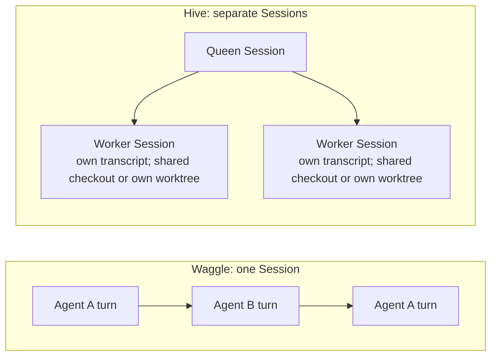

Waggle Mode is optional. It lets two configured agents take turns on one task in the same conversation. For example, one can propose a change and the other can review it.

The agents work **sequentially**, not in parallel. They share the conversation and working directory. If you want separate sessions, each with its own transcript and optionally its own worktree, use a [Hive](/docs/using-openwaggle/hives-and-sessions) instead.

A Waggle takes turns inside one Session, while a Hive runs separate Sessions side by side:



## Setting up presets

1. Open **Settings > Waggle Mode**.
2. Choose a model, role, and display color for Agent A and Agent B. Use models you have connected and enabled.
3. Set **Max turns**, from 4 to 20 in the Settings slider, and choose **Consensus** or **Manual** under **Stop when**. The turn limit is a safety cap in either mode.
4. Save the preset.
5. In a conversation, type `/` and select the saved Waggle preset. It appears as a chip beside your prompt and applies to that send only.

Try a bounded task:

```text
Review the error handling in src/api/client.ts.
Agent A: identify failure cases and propose changes.
Agent B: check those proposals against the callers and tests.
Do not edit files. Finish with agreed findings and any unresolved disagreements.
```

Review the agents' findings yourself. Agreement between two agents is not proof that a change is correct, and each turn uses the selected provider's allowance or billing.

## The presets file

Settings saves your presets as JSON. With a project open, they go to `.pi/waggle-presets.json` in the project, so you can commit them for your team. Without one, they go to `~/.pi/agent/waggle-presets.json`. The list in Settings and the `/` menu combines the built-in presets, the user file, and the project file. A preset with the same `id` as a built-in or user preset replaces it, and the project file wins.

```json
{
  "wagglePresets": [
    {
      "id": "api-review",
      "name": "API review",
      "description": "One agent proposes changes, the other checks them against callers and tests.",
      "config": {
        "mode": "sequential",
        "agents": [
          {
            "label": "Proposer",
            "model": "$inherit",
            "roleDescription": "Identify failure cases and propose concrete changes.",
            "color": "blue"
          },
          {
            "label": "Checker",
            "model": "anthropic/claude-sonnet-4-5",
            "roleDescription": "Check each proposal against the callers and tests. Reject what they do not support.",
            "color": "amber"
          }
        ],
        "stop": {
          "primary": "consensus",
          "maxTurnsSafety": 8
        }
      },
      "isBuiltIn": false,
      "createdAt": 1767225600000,
      "updatedAt": 1767225600000
    }
  ],
  "hiddenBuiltInPresetIds": ["debate"]
}
```

- `config.agents` holds Agent A and Agent B, in turn order. `model` is `$inherit` for the session's model, or a `provider/model` id. `color` is `blue`, `amber`, `emerald`, or `violet`.
- `stop.primary` is `consensus` for **Consensus** or `user-stop` for **Manual**. `stop.maxTurnsSafety` is the turn limit, from 1 to 100 in the file.
- `mode` is always `sequential`.
- `isBuiltIn`, `createdAt`, and `updatedAt` are required. Use `false` for `isBuiltIn`. `createdAt` and `updatedAt` are times in milliseconds since 1970, and Settings sets `updatedAt` each time it saves the preset.
- `hiddenBuiltInPresetIds` hides built-in presets by id: `code-review`, `debate`, or `red-team`.

Settings skips a preset that does not match this format, without an error. It also removes that preset from the file the next time it saves or deletes a preset in that file, because it writes back only the presets it could read. A JSON syntax error hides every preset in the file, and saving a preset to that file fails until you fix it. After editing the file by hand, check the list in **Settings > Waggle Mode**. The format has a JSON Schema, [`waggle-presets.schema.json`](https://openwaggle.ai/schemas/waggle-presets.schema.json). Settings rewrites the file without a `"$schema"` key, so associate the schema in your editor instead, as shown in [Per-project configuration](/docs/configuration/per-project-config#json-schemas-for-editors).

## How it works

1. Agent A receives the task and responds, using available tools when needed.
2. Agent B receives the conversation context, including Agent A's output, and responds.
3. They alternate until the configured stopping condition or turn limit is reached.

The execution bar above the message box appears while the collaboration is starting or running. It disappears when the collaboration finishes, stops, or fails. You can stop it rather than waiting for the turn limit.

## Conflict tracking

When both agents modify the same files, the active Waggle status bar can show a warning naming the file and the two agents. Use the [diff panel](/docs/developer-workflow/git-integration) to review the resulting changes. Edits have already happened on disk; overlap tracking does not approve or undo them.

## Runtime behavior

Waggle uses the same Pi runtime, tools, provider metadata, and session history as a standard session. A Pi extension drives the alternating turns. OpenWaggle shows which agent produced each output and keeps internal coordination prompts out of the visible transcript.

A standard agent can also call `waggle_invoke` to hand a task to a Waggle preset. The standard turn finishes first, then Waggle continues in the same session with the preset and a self-contained handoff prompt. Waggle cannot invoke another Waggle run.

Waggle uses the normal session branch and interruption behavior. Closing the GUI does not by itself stop work owned by the local Session Host. If the process executing a run is interrupted, inspect the restored conversation before asking the agent to continue.
